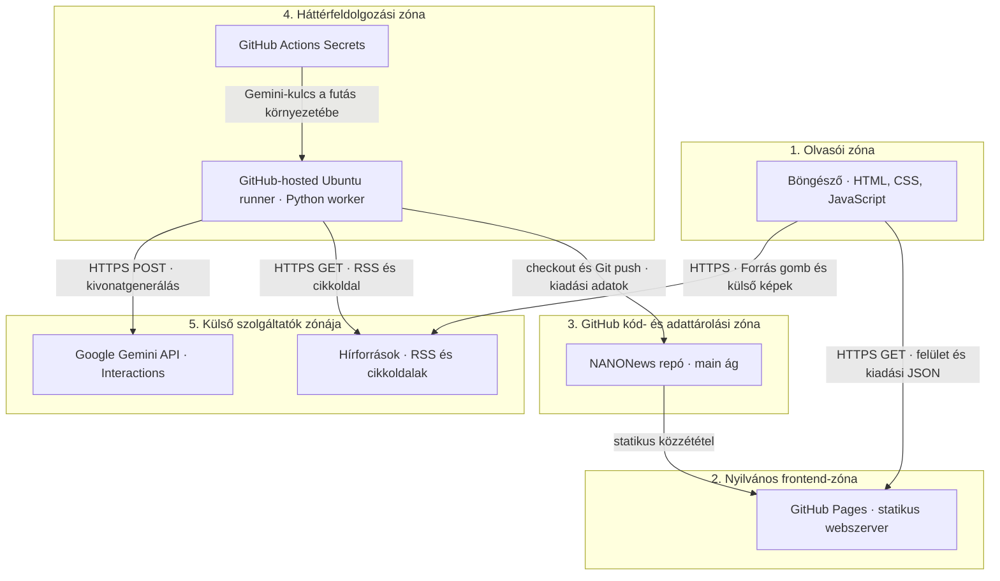

# NANONews rendszerarchitektúra

A NANONews webes felületét a GitHub Pages szolgálja ki. A háttérfeldolgozó a GitHub Actions futtatógépén dolgozik, és JSON-fájlokban adja át a kiadásokat a frontendnek. Az ábra logikai zónákat és szolgáltatási határokat mutat. A GitHub által kezelt belső hálózati topológia kívül esik a dokumentum hatókörén.

## Hálózati zónák és adatáramlás

A zónák közti hálózati hívásokat a böngésző vagy a runner indítja. A böngésző a kiadási JSON-t ugyanarról a GitHub Pages webhelyről tölti be, ahonnan az oldalt. A frontend dinamikus részei a böngészőben futnak. A backend ütemezett feldolgozóként működik, a frontend felé statikus fájlokat ad át.

## Komponensek és tárolás

| Komponens | Szerep | Telepítés és adat |
|---|---|---|
| GitHub Pages | Nyilvános frontend-szerver | Az `index.html` felület és a statikus kiadási adatok kiszolgálása HTTPS-en. |
| Böngésző | Frontend futtatása | Rovatváltás, csoportok, archív kiadások és stílusok megjelenítése. A stílus és az éjszakai mód beállítása helyi böngészőtárolóba kerül. |
| GitHub Actions, `ubuntu-latest` | Backend futtatógép | A `.github/workflows/refresh.yml` indítja a `refresh_news.py` RSS-gyűjtő és kiadáskészítő programot. A futtatógép a feldolgozás idejére áll rendelkezésre. |
| GitHub-repó, `main` | Kód, tartós fájltárolás és átadási pont | `data/latest.json` a legutóbbi kiadáshoz, `data/archive/index.json` és az egyedi archív JSON-ok a korábbi számokhoz, `data/rss-pending.json` a begyűjtött cikkekhez és az előkészített kivonatokhoz. A repó nyilvános. |
| Hírforrások | Külső tartalomszerverek | Telex, HVG, Nemzeti Sport, NBAnews.hu, Fűzővel kifelé!, 444.hu, Portfolio.hu és Origo.hu. |
| Google Gemini API | Külső generálási szolgáltatás | A runner a `generativelanguage.googleapis.com/v1beta/interactions` végpontot hívja. A modell által visszaadott kivonatokat a Python-feldolgozó ellenőrzi és menti. |

## Feldolgozás és jogosultságok

1. A GitHub Actions ütemezetten vagy kézi indításra elindítja a workert. A worker lekéri és szűri az RSS-adatokat. A következő kiadás kivonatainak háttérelőkészítése akkor indulhat, ha a legfrissebb hivatalos kiadás minden cikkéhez elkészült mindhárom változat.
2. A worker a feldolgozandó cikk szövegével, szükség esetén az RSS-kivonattal hívja a Gemini API-t. A `GEMINI_API_KEY` a GitHub Actions titoktárolójából a Python-lépés környezeti változójaként érkezik. A kulcsot a futtató használja a Gemini felé küldött kérés hitelesítéséhez.
3. A workflow `contents: write` jogosultsággal menti az adatfájlokat a főágra. A GitHub Pages a kiadási fájlokat közzéteszi, majd a böngésző HTTPS-en betölti őket.
4. Az állapotjelentés külön ütemezett folyamat. A GitHubon tárolt pillanatképet olvassa, és az aznapi Markdown-jelentést a repó `Dokumentumok` mappájába menti.

## Kapcsolódó dokumentáció

- [Élő NANONews oldal](https://ngynrbrt-prog.github.io/nanonews/)
- [Működési leírás](NANONews-mukodesi-leiras.md)
- [Felhasználói kézikönyv](NANONews-felhasznaloi-kezikonyv.md)
- [Kiadási workflow](../.github/workflows/refresh.yml)
- [Python-feldolgozó](../refresh_news.py)

Az ábrát és a komponenslistát a telepítés, a tárolás, az integrációk vagy a jogosultsági határok változásakor együtt kell frissíteni.
