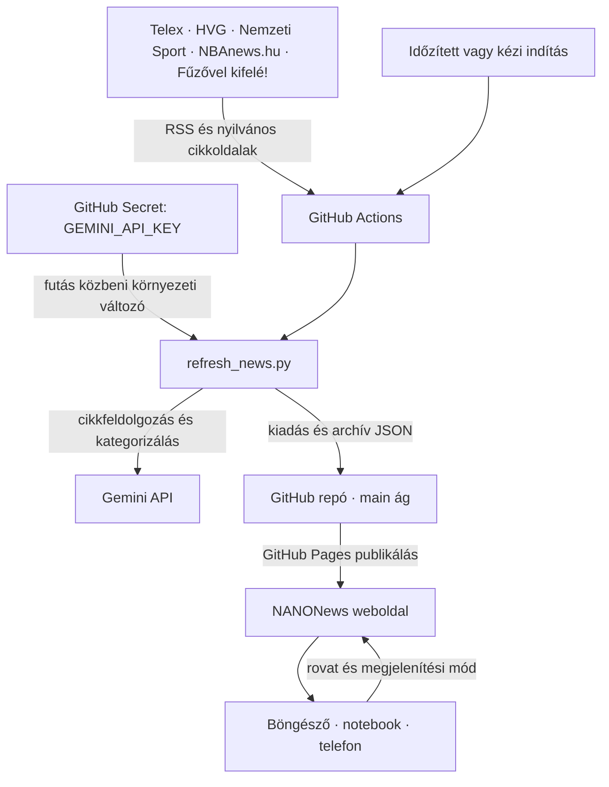
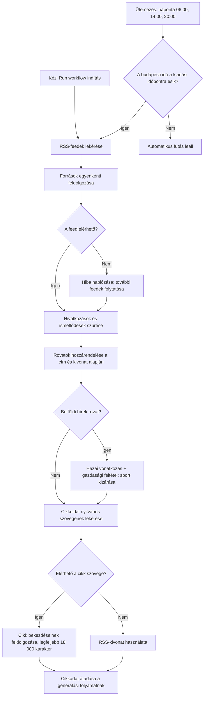
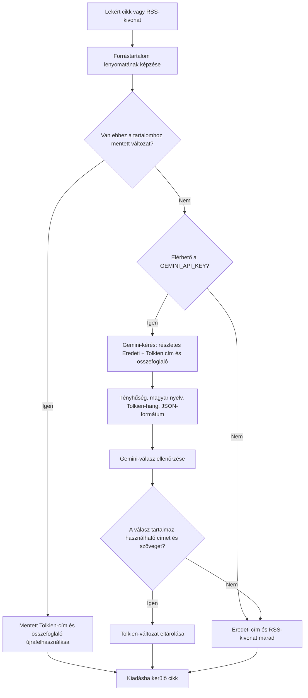
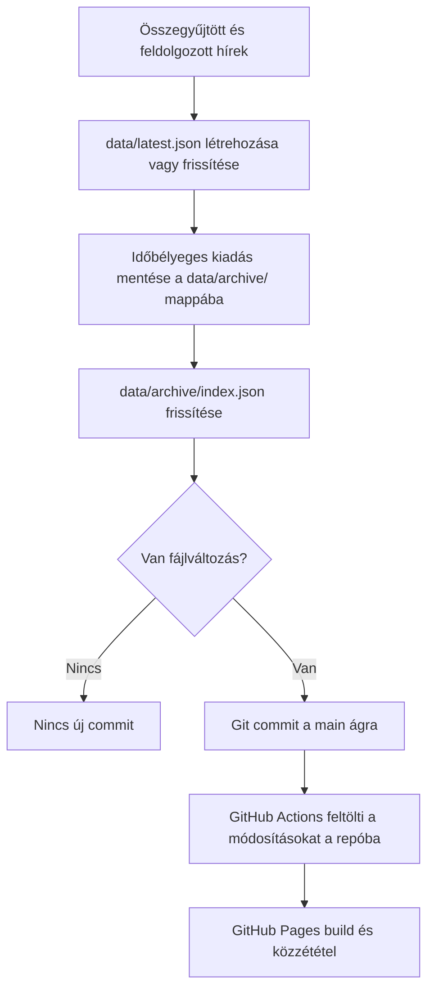
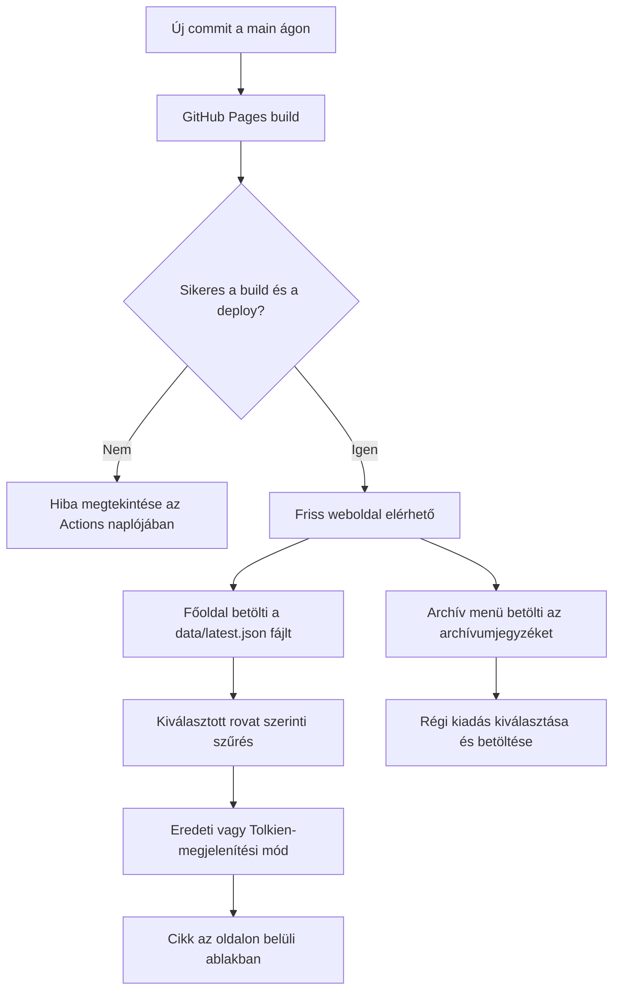

# NANONews – működési és rendszerleírás

Utolsó frissítés: 2026-11-23  
A leírás a repó aktuális működését dokumentálja. A jövőbeni felhasználói kéréseket és az azok alapján végzett módosításokat minden alkalommal rögzíteni kell a dokumentum Változásnapló részében, a munka után pedig az állapotot, az érintett fájlokat és az ellenőrzés eredményét is fel kell jegyezni. Titkot, jelszót vagy API-kulcsot soha nem szabad ebbe vagy más repóban tárolt fájlba írni.

## 1. A rendszer célja

A NANONews magyar nyelvű, személyre szabható, régi újságot idéző digitális hírkiadás. A mobilon és számítógépen is megnyitható GitHub Pages weboldal a legfrissebb kiadást mutatja, és a korábbi számok az Archív lapok lenyitható listájából visszanézhetők.

Az oldal jelenleg statikus webalkalmazás. Nincs külön SQL-adatbázis vagy saját szerver: a friss hírek és az archív példányok JSON-fájlokként a GitHub-repóban tárolódnak. A repó nyilvános, ezért a weboldal, a cikk-metaadatok és az archivált kiadások bárki számára elérhetők.

## 2. Ingyenes összetevők és integrációk

| Összetevő | Feladat | Költségkezelés |
| --- | --- | --- |
| GitHub Pages | A statikus oldal közzététele a NANONews webcímen | A jelenlegi nyilvános repóval ingyenes használatra van beállítva |
| GitHub Actions | RSS-lekérés, cikkoldalak feldolgozása, kiadás- és archívumfájlok készítése, commit | A workflow nem használ fizetős külső ütemezőt vagy szervert |
| Google AI Studio / Gemini API | Tolkien-hangú cím és összefoglaló készítése | A projekt ingyenes keretű használatra van beállítva; nincs fizetős tartalék |
| Hírforrások RSS-ei és nyilvános cikkoldalai | Cím, kivonat, cikk-szöveg és esetenként kép adatforrása | Nyilvánosan elérhető tartalom feldolgozása; fizetőfal vagy belépés megkerülése nélkül |

A szolgáltatók ingyenes keretei és használati korlátai változhatnak. Ha egy ingyenes kvóta kimerül, az AI-átfogalmazás elmaradhat; a rendszer nem áll át automatikusan fizetős szolgáltatásra. A Google AI Studio-ban a kulcs a Free tier projekthez tartozik. A fizetős számlázást nem szabad bekapcsolni a NANONews működtetéséhez.

### Rendszerarchitektúra

Az adatfeldolgozás ütemezetten vagy kézi indítással történik. A GitHub Actions futtatja a Python-feldolgozót, a Gemini API-kulcsot GitHub Secretből kapja meg, a kimeneti JSON-fájlok pedig a repóba kerülnek. A GitHub Pages ezekből szolgálja ki az oldalt számítógépen és mobilon.

Az API-kulcs csak a workflow futásakor jut el a feldolgozóhoz, és a generálásnál kerül tovább a Gemini API-hoz. A böngésző nem kapja meg a kulcsot.

## 3. Források

A források és lekérési módok a refresh_news.py fájlban vannak beállítva:

- Telex — https://telex.hu/rss
- HVG — https://hvg.hu/rss
- Nemzeti Sport — elsődlegesen https://www.nemzetisport.hu/publicapi/hu/rss/nso/articles
- Nemzeti Sport tartalék feed — https://www.nemzetisport.hu/static/rss_hirek.xml
- NBAnews.hu — https://nbanews.hu/feed/
- Fűzővel kifelé! — https://fuzovelkifele.com/feed/ (WordPress RSS; NFL-cikkek)

A nem elérhető RSS-végpont hibáját a workflow naplózza, a többi feed feldolgozása ettől még folytatódik. A cikkcímeket, hivatkozásokat, kivonatokat és képeket az RSS-feedekből dolgozza fel, majd megpróbálja letölteni a nyilvánosan olvasható cikk szövegét. A forrás neve minden cikk mellett megjelenik. A témába sorolás a cikk címe és RSS-kivonata alapján történik.
## 4. Rovatok és szűrés

A megjelenő rovatmenü az index.html fájl topics listájában van. A gyűjtő- és témaszabályok a refresh_news.py fájl rules listájában, valamint a Belföldi hírek külön osztályozójában találhatók.

Jelenlegi rovatok:

- Arsenal
- Manchester City
- Bayern München
- Manchester United
- Como
- Premier League
- F1
- NBA
- NFL
- Seattle Seahawks
- Kerékpár
- Belföldi parlament
- Belföldi tőzsde
- Külföldi tőzsde
- Belföldi hírek

A Belföldi hírek rovat kizárólag olyan híreket jeleníthet meg, amelyek magyarországi vagy magyar vonatkozásúak, gazdasági témát tartalmaznak, és nem sporthírek. A feldolgozó gazdasági kulcsszókat és hazai vonatkozásra utaló kifejezéseket vizsgál; sportrovatba sorolt cikket vagy sportkifejezéseket tartalmazó hírt kizár. A weboldal ugyanezt a szűrést alkalmazza az archív kiadások megjelenítésekor is, ezért a korábbi, tágabb szabály szerint elmentett sporthírek sem kerülnek be a Belföldi hírek rovatba.

A rovatok bővítésekor a rovat feliratát az index.html fájlban, a begyűjtési szabályt pedig a refresh_news.py fájlban kell frissíteni. A történeti adatokban elmentett kategóriák miatt a felületi szűrést is felül kell vizsgálni.

## 5. Kiadásrend és ütemezés

A .github/workflows/refresh.yml GitHub Actions workflow naponta három tervezett kiadást készít:

- 06:00
- 14:00
- 20:00

Az időzóna Europe/Budapest. A GitHub UTC-alapú cronja mind a téli, mind a nyári időszámítást lefedi; a Python program ellenőrzi a helyi budapesti órát, és csak a fenti időpontok valamelyikében készít automatikus kiadást. A GitHub Actions indítása néha késhet, ezért az ütemezés tervezett időpont, nem másodpercre garantált futás. A workflow kézzel is indítható a repó Actions → Refresh NANONews → Run workflow felületén; a kézi indításnál az időkorlát ellenőrzése nem állítja le a futást.

## 6. Hírek feldolgozásának folyamata

1. A GitHub Actions elindítja a refresh.yml workflow-t, és lekéri a repót.
2. A refresh_news.py beolvassa a források RSS-feedjeit, kiszűri az ismétlődő hivatkozásokat, majd a cím és a kivonat alapján témákat rendel a hírekhez.
3. A program megpróbálja lekérni a cikkoldal nyilvánosan elérhető törzsszövegét. A feldolgozó a cikk bekezdéseit keresi, és legfeljebb 18 000 karaktert használ fel. Ha a cikk nem érhető el vagy nincs elegendő nyilvános szöveg, az RSS-kivonat lesz az alapanyag.
4. A forrás tartalmának lenyomata alapján ellenőrzi, hogy az adott változat már elkészült-e. Változatlan cikkek meglévő Tolkien-változatát újra felhasználja, hogy ne kérjen feleslegesen új generálást.
5. Ha van használható Gemini-kulcs, a program egy kérésben rövid, semleges Eredeti összefoglalót, valamint Tolkien-hangú címet és rövid összefoglalót kér. Mindkét összefoglaló 2–3 rövid mondatos; a program a kimenetet legfeljebb három mondatra és 900 karakterre korlátozza. A prompt előírja a tények megtartását, az új tények és fantasy-elemek tiltását, valamint a JSON-választ.
6. A program létrehozza vagy frissíti a data/latest.json fájlt, hozzáad egy időbélyeges kiadást a data/archive/ mappához, majd frissíti a data/archive/index.json archívumjegyzéket. Legfeljebb 80 cikk kerül egy kiadásba.
7. Sikeres fájlváltozás esetén a workflow commitolja az adatfájlokat a main ágra. A GitHub Pages a repó új állapotából közzéteszi a friss oldalt.

### Folyamatábrák

#### Kiadás indítása és hírgyűjtés

A feedhiba nem állítja le a többi forrás feldolgozását. A kézi indításnál az időzítési ellenőrzés kimarad; automatikus indításnál csak a megfelelő budapesti időablak folytatódik.

#### Eredeti összefoglaló és Tolkien-változat

A generálás a nyilvánosan elérhető cikk szövegét használja, ha az lekérhető; különben az RSS-kivonatot. Az eredeti és a Tolkien-változat külön mezőkben marad meg, ezért a weboldal választója a címet és az összefoglalót együtt tudja váltani.

#### Kiadás mentése és feltöltése a repóba

#### Publikálás és megjelenítés

A GitHub Actions futás sikeressége és a Pages közzététele külön állapot. A frissítés akkor tekinthető teljesnek, ha az adatfájlok commitja megvan, a Pages build/deploy sikeres, és az élő oldalon az új kiadás megjelenik.

## 7. AI-generálás és megjelenítési módok

A felület két, egymástól elkülönített beállításcsoportot kínál:

- **Írás stílusa:** Eredeti vagy Tolkien tollából. Ez választja ki, hogy a hír címe és összefoglalója eredeti vagy Gemini által Tolkien hangján átírt változatban jelenjen meg.
- **Éjszakai mód:** önálló be/ki kapcsoló a fejléc közepén, a napi dátummal egy sorban, közvetlenül a NANONews cím fölött. Bekapcsolva az egész oldal sötét színtémára vált; az állapot kikapcsolásig és oldalfrissítés után is megmarad.

Az Írás stílusa választó a rovatmenü alatt, a cikkrész teljes szélességében jelenik meg. A Rovataim és az Írás stílusa részek összecsukható natív lenyíló panelként működnek, alaphelyzetben nyitva. Asztali nézetben a fejlécben a „Budapest · személyes Napközbeni lap” balra, az éjszakai kapcsoló középre, a dátum és a sorszám jobbra rendeződik; mobilon középre rendezve a városnév, a dátum, majd a kisebb éjszakai kapcsoló következik. A fejléc dátuma után /1 jelöli a reggeli, /2 a délutáni, /3 az esti kiadást. A sorszámot a kiadás updatedAt időpontjából, Europe/Budapest szerint számolja; archív lap megnyitásakor annak dátuma és sorszáma jelenik meg. Az éjszakai kapcsoló nincs az írásstílus választóval egy sorba rendezve, és a sötét téma mellett is használható mindkét írásstílus. A generált változat a hír mellett és a cikket az oldalon belül megnyitó ablakban is megjelenik. A felhasználó nem navigál el a NANONews oldaláról a forrásra. A generált szöveg összefoglaló; nem a teljes cikk újramondása vagy másolata. A cikkfotó, ha a feed szolgáltat képet, nyomdai hatású, egyszerűsített képként jelenik meg.

A kiadás JSON-jában a tárgyilagos, 2–3 mondatos Eredeti összefoglaló a variants.original.body mezőben, a Tolkien-változat címe és 2–3 mondatos összefoglalója a variants.tolkien.title és variants.tolkien.body mezőkben szerepel. Eredeti stílusban a forrás eredeti címe marad, a hírhez pedig a cikk nyilvánosan elérhető szövegéből készült 2–3 mondatos összefoglaló társul. Ha a generálás nem sikerül vagy nincs API-kulcs, a felület az eredeti címet és legfeljebb három mondatra rövidített RSS-kivonatot jeleníti meg. Így egy generálási hiba nem akadályozza a kiadás megjelenítését.

A generálás jelenlegi modellje a kódban gemini-3.5-flash-lite, az API-hívás a Google Interactions API v1beta végpontjára megy. A modell- és végpontbeállítás a refresh_news.py fájlban módosítható.

## 8. API-kulcsok és titokkezelés

A Gemini API-kulcs a Google AI Studio-ban jön létre. A kulcs értéke kizárólag a GitHub Actions titokkezelőjébe kerülhet, a repóban GEMINI_API_KEY néven. A .github/workflows/refresh.yml a titkot futáskor környezeti változóként adja át a refresh_news.py programnak.

A kulcs biztonságos útja:

1. Google AI Studio: a Free tier projekthez API-kulcs készül.
2. GitHub repó: Settings → Secrets and variables → Actions → Repository secrets.
3. A titok neve GEMINI_API_KEY; a GitHub titkosítva tárolja.
4. A workflow futásakor a kulcs környezeti változóként érhető el a Python-folyamat számára.
5. A generálási kérések az x-goog-api-key fejlécen adják át a kulcsot a Google API-nak.
6. A kulcs nem kerülhet JSON-kiadásba, HTML-be, naplóba, commitba, képernyőképbe vagy dokumentumba.

Ha a kulcs cserére szorul, új kulcsot kell létrehozni, a GitHub Actions titok értékét frissíteni, majd egy kézi workflow-futtatással ellenőrizni a működést. A régi kulcs visszavonása előtt meg kell győződni arról, hogy nem használja-e más projekt vagy integráció. Ne kérj és ne fogadj API-kulcsot chatüzenetben; ne jelenítsd meg a vágólap vagy az űrlap értékét ellenőrzéskor.

## 9. Weboldal és archívum

A főoldal a data/latest.json fájlt tölti be, cache nélküli lekéréssel. A hírek újságszerű hasábokban jelennek meg, a kiválasztott rovat szűri a teljes tartalmat. A rovatok témacsoportokba rendezve jelennek meg: a sportrovatok az első sorban, a többi rovat a következő sorban. Kis képernyőn a csoportokon belüli elemek további sorokba törnek. A „KIADÁS FRISSÍTVE” időbélyeg az összes cikk alatt, az Archív lapok fölött jelenik meg; a kiadási idő a rovat szűrésétől függetlenül látható.

Az Írás stílusa választása (nanonews-style) és az Éjszakai mód állapota (nanonews-theme) külön kulcson, a böngésző helyi tárolójában marad meg, nem szerveroldali felhasználói profilban. A fejlécben lévő éjszakai kapcsoló oldalbetöltéskor visszaállítja a mentett állapotot, és újabb kattintásig bekapcsolva marad. Az Archív lapok egy lenyitható, legfrissebbtől legrégebbiig rendezett listában jelennek meg; egy régi szám kiválasztásakor az oldal annak a kiadásnak a JSON-fájlját tölti be. A Források és Kiadásrend tájékoztató blokkok az archív lista után, az oldal alján jelennek meg; mobilnézetben egymás alá törnek.

A weboldal nyilvános elérhetősége: https://ngynrbrt-prog.github.io/nanonews/

## 10. Hibakezelés és korlátok

- Egy hibás RSS-feed nem akadályozza meg a többi forrás lekérését.
- Ha a forrásoldal 404/503 hibát ad, vagy a cikk szövege nem olvasható, a cikk kimaradhat a kiadásból, vagy az RSS-kivonat lehet az alapanyag.
- Ha a Gemini API hibát ad, a kvóta kimerült, vagy a válasz nem megfelelő JSON, az adott hírhez nem biztos, hogy létrejön Tolkien-változat. Az eredeti szöveg megmarad.
- A GitHub Actions vagy Pages késése késleltetheti az új kiadás közzétételét.
- A GitHub Pages nyilvános; ne tárolj benne személyes adatot vagy hozzáférési tokent.
- A rendszer jelenleg fájlalapú. A Git-repó tölti be a kiadás-adattár szerepét; külön adatbázis-integráció nincs beállítva.

## 11. Módosítások és publikálás

Kód- vagy rovatváltoztatáskor az érintett forrásfájlokat a main ágra kell menteni. A weboldal működésének része lehet az index.html, refresh_news.py, .github/workflows/refresh.yml, README.md és a data/ kiadási adatai.

Módosítás után ellenőrizendő:

1. A változás a megfelelő GitHub-fájlban szerepel-e.
2. A GitHub Actions workflow lefutott-e, és sikeres-e.
3. Sikeres frissítésnél változott-e a data/latest.json és készült-e archív példány.
4. A GitHub Pages közzétette-e a friss HTML-t és adatokat.
5. A Tolkien mód és a megfelelő rovat működik-e az élő oldalon.

A helyi tesztek futtatása csak külön kérésre történik; a publikált oldal és a workflow állapotának ellenőrzése ettől független működés-ellenőrzés.

## 12. Változásnapló

### 2026-11-23 — dokumentáció és alapfolyamat
- Rögzítve az ingyenes GitHub Pages + GitHub Actions + Google AI Studio felépítés, a feedek, az archívum, az ütemezés és a titokkezelés.
- Gemini API-kulcs a GitHub Actions GEMINI_API_KEY titokban van tárolva; a generálási workflow sikeresen lefutott.
- Az új kiadásban 41 hír készült, ebből 38-hoz Tolkien-cím és összefoglaló állt rendelkezésre; három cikkhez forrásoldali hiba miatt nem készült átírás.
- Ellenőrizve: a Tolkien mód a kártyacímeket és a megnyitott cikk címét, valamint az összefoglalót is átváltja.

### 2026-11-23 — Belföldi hírek rovat gazdasági szűrése
- Kérés: a Belföldi hírek rovat kizárólag gazdasági híreket tartalmazzon, sportot ne.
- Módosítva: refresh_news.py hazai + gazdasági + sportkizáró feltételei; index.html ugyanilyen szűrése az új és archív kiadásokra.
- Ellenőrzés: a kézi frissítési futás (#10) sikeresen lezárult; a 12:06-os kiadás 31 cikket tartalmaz, mind a 31-hez készült Tolkien-változat. A Belföldi hírek kategóriában 4 gazdasági hír szerepel; sportkategóriájú cikk nem került bele.
- Közzététel: a főoldalon a rovat kiválasztásakor ellenőriztem, hogy sportcikkek nem jelennek meg.
- További felületi pontosítás: a fejléc most mindhárom kiadási időt mutatja; eltávolítva az elavult „első kiadás készül / adatbázis bekötése szükséges” üzenet. A módosítás közzétéve; az élő oldalon megerősítettem a napi három időpontot és az elavult üzenet eltávolítását.

### 2026-11-23 — Fűzővel kifelé!, Eurosport és sportrovatrendezés
- Kérés: rendszeresen lekérni a Fűzővel kifelé! és Eurosport portált; NFL és Seattle Seahawks rovatot, valamint Kerékpár rovatot felvenni; a sportrovatokat az első sorba, az egyéb rovatokat külön sorba rendezni. A Belföldi parlament a nem sportos rovatok közé került.
- Módosítva: refresh_news.py a Fűzővel kifelé! RSS-ével (NFL-kategóriába sorolva) és a Eurosport legfrissebb hírek listájának lekérésével; index.html NFL, Seattle Seahawks és Kerékpár rovatával, valamint két soros rovatcsoportjaival.
- A Eurosport magyar oldalon nem találtam hivatalos RSS-végpontot; a nyilvános /latest-news.shtml oldalból a cikkcímek és cikkhivatkozások kerülnek feldolgozásra.
- Ellenőrzés: a Fűzővel kifelé! feed a böngészőben elérhető volt, RSS-elemeket, nyilvános cikk-szöveget és képeket adott. A Eurosport legfrissebb hírek oldala böngészőben ellenőrizve. Az első kézi kiadás sikeres lett, de az Actions HTML-listázója nem talált linket; a parser most az `aria-label` címet is feldolgozza. A Google News RSS próbát automatikus lekérés blokkolta, ezért nem erre épül a rendszer. Az új parserrel még egy frissítés szükséges a működés igazolásához.
- Mermaid-megjelenítés: a publikálási folyamatábrában a fenntartott „style” azonosító „mode”-ra javítva.

### 2026-11-23 — működési dokumentáció folyamatábrái
- Kérés: architektúra-ábra és részletes folyamatábrák a gyűjtéshez, összefoglalóhoz, Tolkien-módhoz, kiadásmentéshez és publikáláshoz.
- Elkészült: Mermaid-ábrák kerültek a működési leírás megfelelő fejezeteibe; külön jelölve az automatikus és kézi indítás, a feedhiba, a cikk/RSS-tartalom választása, a kulcs használata, az archívum mentése, a GitHub-commit és a Pages deploy.
- Állapot: feltöltve a main ágra; a dokumentum GitHub Markdown előnézetében ellenőrizve.

### 2026-11-23 — Seattle Seahawks rovat és rovatcsoportok
- Kérés: Seattle Seahawks külön rovatként jelenjen meg a sportos rovatcsoportban; a Belföldi parlament maradjon a második, nem sportos csoportban.
- Ellenőrizve a közzétett forrásban: a Seattle Seahawks gomb a sportos csoporthoz van rendelve, a Belföldi parlament és a többi nem sportos rovat a második csoportban jelenik meg. A Seattle Seahawks kulcsszavas szűrése a hírgyűjtésnél és az oldalon is be van állítva; sporthírként a Belföldi hírekből is kizáródik.
- A megjelenítéshez nem szükséges fizetős szolgáltatás.

### 2026-11-23 — frissítési idő és cikkek megjelenési ideje
- Kérés: a kiadás frissítési időpontja üres rovatnál is maradjon látható; minden cikk alján jelenjen meg a forrás szerinti megjelenési idő.
- Módosítva az index.html: a „FRISSÍTVE” időpont beállítása a rovat szerinti szűrés előtt történik, ezért találat nélküli rovatnézetben sem tűnik el. A kiválasztott régi archív kiadás saját frissítési idejét mutatja.
- Módosítva az index.html: a főcikk, a rovatcikk-kártyák és a cikken belüli ablak alján megjelenik a forrás RSS-ében lévő publikálási dátum és idő. Ha a forrás nem ad meg vagy nem értelmezhető időpontot, a felület ezt jelzi, nem állít be kitalált értéket.

### 2026-11-23 — üres rovat frissítési ideje és cikk-időpontok
- Kérés: a kiadás frissítési ideje üres rovatnál is maradjon látható; minden cikk alján jelenjen meg a forrás szerinti megjelenési idő.
- Módosítva az index.html: a „FRISSÍTVE” időpont beállítása a rovat szerinti szűrés előtt történik, ezért találat nélküli rovatnézetben sem tűnik el. Régi archív kiadás megnyitásakor annak saját időpontja jelenik meg.
- Módosítva az index.html: a főcikk, a rovatcikk-kártyák és a cikken belüli ablak alján megjelenik a forrás RSS-ében lévő publikálási dátum és idő. Ha a forrás nem ad vagy nem értelmezhető időpontot, a felület ezt jelzi.

### 2026-11-23 — ismétlések kizárása a rendes kiadások között
- Kérés: a tesztgenerálások ne számítsanak korábbi lapszámnak; a 14:00-s szám a 06:00-s rendes lap után megjelent, rovatba illő híreket tartalmazza, a reggeli vagy korábbi lapszámok híreit ne ismételje.
- Módosítva a refresh_news.py: a tesztkiadások (`testEdition: true`) figyelmen kívül maradnak a korábbi hivatkozások és a legutóbbi rendes kiadási időpont meghatározásakor. A hírgyűjtő kizárja a régebbi rendes számokban már szereplő URL-eket, továbbá összeveti az RSS vagy a nyilvános cikkoldal publikálási idejét a legutóbbi rendes kiadás időpontjával.
- Ha egy hír publikálási ideje nem állapítható meg, a legutóbbi rendes kiadáshoz képest nem kerül be. Így a tesztlapok nem blokkolják az új híreket; a 14:00-s rendes kiadás pedig csak az előző rendes lap óta publikált tartalmat veheti fel.
- Ha egy rovatban nincs új cikk, a rovat üres marad; a felület ettől még mutatja a kiadás frissítési idejét.

### 2026-11-23 — mobilos elrendezés és megjelenítésválasztó
- Kérés: javítani a mobilos rovatmenü és cikkek megjelenését; az Eredeti/Tolkien választó közvetlenül a rovatmenü alatt, a cikkek előtt jelenjen meg.
- Módosítva az index.html: a hangnemválasztó kikerült az oldalsávból, és a rovatmenü utáni, teljes szélességű eszközsávba került.
- A rovatmenü Sportrovatok és További rovatok címkékkel különíti el a két csoportot. Mobilon a témák kétoszlopos, nagyobb tappolási felületű rácsba rendeződnek; a sportos csoport marad elöl.
- Mobilnézetben szűkebb oldalsó margók, képernyőhöz illő cikkképek és címméretek, jól olvasható kártyaközök, könnyebben kezelhető archívum és cikkablak szerepel. Keskeny nézetben a cikkkártyák egy oszlopba törnek, a kép teljes szélességben felülre kerül, a cím és a szöveg alá; a hosszabb címek és összefoglalók is tördelhetők, hogy ne lógjanak ki a kártyából.

### 2026-11-23 — éjszakai megjelenítés
- Kérés: az Eredeti és Tolkien lehetőség mellett legyen választható éjszakai mód.
- Módosítva az index.html: az Éjszakai gomb sötét, majdnem fekete háttérre, meleg régi papír árnyalatú betűszínre és sötétebb cikkelválasztó felületekre vált. A képek is visszafogottabb fényerőt kapnak.
- Az éjszakai mód csak a színeket módosítja; nem változtat a hír tartalmán. A választás a böngésző helyi tárolójában megmarad, és a mobilos háromgombos választósorba is beilleszkedik.

### 2026-11-23 — stílusválasztó és éjszakai mód elkülönítése
- Kérés: a Stílus alatt Eredeti és Tolkien tollából legyen választható; ettől teljesen külön, Megjelenítés cím alatt lehessen az éjszakai módot ki- és bekapcsolni. Az éjszakai téma mellett mindkét szövegstílusnak működnie kell.
- Módosítva az index.html: a hangnemcsoport címe „Stílus”; a két lehetőség „Eredeti” és „Tolkien tollából”. A külön „Megjelenítés” csoportban egy önálló, be/ki állapotú Éjszakai mód kapcsoló van.
- A Stílus beállítás a címet és az összefoglalót választja; az éjszakai kapcsoló kizárólag a színeket változtatja. A kettő külön helyi tárolási kulcson marad, így az Eredeti és a Tolkien tollából mód éjszakai megjelenítésben is használható.
- Mobilon a két beállításcsoport egymás alatt jelenik meg. Régi mentett Tolkien választás megmarad; a régi egyesített Éjszakai értéket a rendszer külön megjelenítési beállításként migrálja.
- Állapot: a forrásfrissítés és a dokumentáció a main ágra került; a GitHub Pages közzétette a változást. Az élő oldalon ellenőrizve, hogy Éjszakai módban az Eredeti és a Tolkien tollából is választható, és a két stílus tartalma működik.

### 2026-11-23 — éjszakai kapcsoló áthelyezése
- Kérés: az Írás stílusa felirat alatt csak az Eredeti és a Tolkien tollából maradjon. Az Éjszakai mód kerüljön külön a fejlécbe, a Budapest-sor után középre, a NANONews cím fölé.
- Módosítva az index.html: az éjszakai kapcsoló a fejlécben van; kikerült az írásstílus választójából. A sötét mód az egész oldalt érinti, és a külön nanonews-theme helyi beállításból töltődik vissza, amíg a felhasználó ki nem kapcsolja. Az egyelemű Írás stílusa panel teljes szélességben jelenik meg; az aktív éjszakai kapcsoló kontrasztját külön beállítottuk.
- Az Eredeti/Tolkien választás saját nanonews-style beállításon marad, így mindkét írásstílus működik bekapcsolt éjszakai mód mellett is.
- A leírás és a kódbeli felületi elrendezés frissítve. A GitHub Pages friss kiadása sikeresen lefutott; az élő oldalon látható, hogy az éjszakai kapcsoló a fejlécben, a Budapest-sor alatt és a lapcím fölött van. Bekapcsolva az oldal sötét módba vált, újratöltés után is úgy marad, az Írás stílusa pedig külön választóként működik.

### 2026-11-23 — fejléc dátuma, lapszám és teljes szélességű írásstílus
- Kérés: az Írás stílusa panel nyúljon a teljes szélességre; a dátum és az éjszakai kapcsoló egy középre rendezett fejlécsorban, közvetlenül a NANONews cím fölött jelenjen meg; a dátum után legyen kiadási sorszám.
- Módosítva az index.html: a dátumsor és az éjszakai kapcsoló egy közös, középre rendezett fejlécsorba került. A sötét mód továbbra is megjegyzi az állapotát, az írásstílus-választó külön marad.
- A dátum a betöltött kiadás updatedAt értékéből származik. Europe/Budapest helyi órája alapján a fejléc /1-et mutat 06:00-s reggeli kiadásnál, /2-t 14:00-s délutáni kiadásnál, /3-at 20:00-s esti kiadásnál. Archív lap megnyitásakor annak dátuma és lapszáma jelenik meg.
- Az Írás stílusa panel teljes szélességre nyúlik; mobilon is a rendelkezésre álló szélességet tölti ki.
- Állapot: a forrás és a dokumentáció a main ágra került; a Pages frissítése után az élő oldalon ellenőrizendő.

### 2026-11-23 — fejléc megnevezése
- Kérés: a „Budapest · személyes digitális napilap” fejlécszöveg legyen „Budapest · személyes Napközbeni lap”.
- Módosítva az index.html: a fejlécben az új megnevezés jelenik meg.
- Állapot: a módosítás a main ágra került, a GitHub Pages közzététele sikerült. Az élő oldalon ellenőrizve az új fejlécszöveg, a középre rendezett dátum és kiadásszám, a kapcsoló helye, valamint a teljes szélességű Írás stílusa sáv.

### 2026-11-23 — fejlécoszlopok, összecsukható részek és írógépbetű
- Kérés: asztali fejlécben a helymegjelölés legyen balra, az éjszakai mód középre, a dátum jobbra rendezve; a Rovataim és Írás stílusa rész legyen összecsukható; a betűk hasonlítsanak jobban írógéphez.
- Módosítva az index.html: a három fejléc-elem asztali nézetben egy sorban, három oszlopban jelenik meg; mobilon középre rendezve egymás alá törik.
- A Rovataim és az Írás stílusa natív összecsukható panelt kapott, alapértelmezés szerint nyitott állapotban.
- A Playfair/Source Sans családot Courier Prime írógépbetű váltotta; a kisebb feliratok DM Mono betűvel maradtak.
- Állapot: a forrásmódosítás main ágra került; GitHub Pages workflow #104 sikeres. Az élő oldalon ellenőriztem a háromoszlopos fejlécet, a sötét témát, az összecsukható Rovataim és Írás stílusa paneleket, valamint az írógépbetűs megjelenést.

### 2026-11-23 — Telex RSS-lekérés ellenőrzése
- Kérés: ellenőrizni, hogy a NANONews le tudja-e kérni a Telex cikkeit, mert a kiadásokban nem láthatók.
- A forrás konfigurálva van a `refresh_news.py` fájlban `https://telex.hu/rss` címen. A legutóbbi kézi frissítés (Actions #11) naplójában a Telex feed lekérése `HTTP Error 403: Forbidden` hibával végződött.
- A legfrissebb, 2026-11-23 12:25-kor frissített tesztkiadás 32 cikket tartalmazott, Telex-cikket nem. Ezért jelenleg a Telex hírei nem jutnak el a kiadásba; a megfigyelt hiba a forrás RSS-hozzáférésénél jelentkezik, nem a webes rovatválasztásnál.
- Állapot: ellenőrizve és dokumentálva. A Telex tényleges lekérése jelenleg nem működik; a feed-hozzáférés javítása külön feladat.

### 2026-11-23 — Források és kiadásrend az oldal alján
- Kérés: a Források és a Kiadásrend az oldal alján legyen feltüntetve.
- Módosítva az index.html: a két tájékoztató blokk kikerült a cikk melletti sávból, és az archív lapok után, a lábléc fölé került.
- Reszponzív elrendezés: asztali nézetben két egymás melletti blokk, keskeny képernyőn egymás alatti blokkok.
- Ellenőrzés: az élő Pages oldalon ellenőrizendő a publikálás után.

### 2026-11-23 — hosszabb Eredeti összefoglalók
- Kérés: Eredeti írásstílus kiválasztásakor legyen hosszabb és részletesebb az összefoglaló.
- Módosítva a refresh_news.py: a meglévő Gemini-kérés most egy semleges, tárgyilagos, 5–7 mondatos részletes összefoglalót is kér a Tolkien-változat mellett. Ez ugyanabban az API-kérésben készül, de a hosszabb válasz növeli a generálási tokenhasználatot.
- Módosítva az index.html: Eredeti módban a forráscím változatlan marad, a kártyán és a cikken belüli ablakban a variants.original.body jelenik meg. Ha még nincs ilyen elmentett változat, a felület a korábbi RSS-kivonatra esik vissza.
- A következő kiadásfrissítés állítja elő az új mezőt az újonnan feldolgozott cikkekhez; a korábbi archív lapok csak újragenerálás után kapnak hosszabb összefoglalót.
- Állapot: kód és dokumentáció a main ágra került; Pages publikálás és a következő kiadásgenerálás után ellenőrizendő.

### 2026-11-23 — kiadásfrissítési idő az összes cikk alatt
- Kérés: a kékkel kijelölt „KIADÁS FRISSÍTVE” sort az összes cikk alá, közvetlenül az Archív lapok fölé helyezni.
- Módosítva az index.html: az időbélyeg kikerült a főcikkből, és a főcikket, valamint a rovatcikkeket tartalmazó lista után, az archívum elé került.
- Az időbélyeg a kiválasztott rovat üressége esetén is megmarad; az aktuális kiadás updatedAt értékét mutatja.
- Állapot: a forrásmódosítás main ágra került; Pages-publikálás után az élő oldalon ellenőrizendő.

### 2026-11-23 — nem elérhető források eltávolítása
- Kérés: azokról az oldalakról, ahonnan nem érkezik adat, kerüljön ki a forráslista.
- Ellenőrzés: a 2026-11-23 14:09-es automatikus frissítésben Telex 10, HVG 11, NBAnews.hu 3, Nemzeti Sport 5 és Fűzővel kifelé! 1 cikkel szerepelt. A Telex korábbi 403-as hibája után most sikeresen betöltött.
- Az Index RSS-végpontja HTTP 404-et adott, az Eurosport oldal parseréből nem érkezett cikkhivatkozás. Mindkettő eltávolítva a refresh_news.py forráskonfigurációjából és az oldal aktív forráslistájából; az Eurosporthoz tartozó lekérő kód is kikerült.
- A Nemzeti Sport elsődleges feedje működött; a tartalék feed 404-es hibája miatt a forrás összességében megmaradt. A cikkoldalakhoz tartozó időszakos 503-as generálási hibák nem a feed-lekérést érintették, ezért ezek a működő források maradnak.
- Állapot: kód és dokumentáció a main ágra került; Pages-publikálás után az aktív forráslista ellenőrizendő.

### 2026-11-23 — mobil tördelés és éjszakai kapcsoló
- Kérés: mobilon ne csússzanak szét a hírek; az éjszakai mód a dátum alá kerüljön kisebb méretben.
- Módosítva az index.html: mobilon a rovatok után a képes cikkkártyák egy oszlopban jelennek meg; a kép teljes szélességben a cím fölé kerül, a szöveg alatta folytatódik. A hosszú címek és összefoglalók sortörése megakadályozza a kártyák szétnyúlását.
- A mobil fejléc sorrendje: városmegjelölés, dátum és lapszám, majd a kisebb éjszakai kapcsoló.
- Ellenőrzés: Pages-publikálás (#119) sikeres; a keskeny mobil tördelést kb. 680 CSS-pixeles nézeten vizuálisan ellenőriztem. A cikkképek, címek és összefoglalók nem lógnak ki, az éjszakai kapcsoló a dátum alatt jelenik meg.
- Állapot: közzétéve és ellenőrizve.

### 2026-11-23 — rövid, 2–3 mondatos összefoglalók és Tolkien-hibák
- Kérés: ezentúl mind az Eredeti, mind a Tolkien tollából változat legyen lényegretörő, 2–3 mondatban; meg kellett vizsgálni, hogy a hiányzó Tolkien-szövegeket a kvóta kimerülése okozta-e.
- A 2026-11-23 14:09-kor készült hivatalos kiadás 30 cikkéből 7-hez volt elmentve Eredeti és Tolkien változat, 23 cikkhez nem. A GitHub Actions #12 sikeresen lefutott, de a Gemini-hívások 23 esetben HTTP 503 Service Unavailable hibát adtak. Ez átmeneti szolgáltatási túlterhelésre utal; a naplóban HTTP 429 kvótahiba nem szerepelt, ezért a kvóta kimerülése nem igazolható.
- Módosítva a refresh_news.py: a prompt mindkét változatnál 2–3 rövid mondatot kér; a kód legfeljebb három mondatra és 900 karakterre vágja az összefoglalókat, az RSS-es tartalékot is rövidíti, és 503 esetén legfeljebb két újrapróbálkozást végez.
- A rövid összefoglalók új verziójelölést kapnak, így a régi, hosszú változatok nem kerülnek újra felhasználásra, ha ugyanaz a cikk újra feldolgozásra kerül. A jelenleg elmentett kiadás és az archív példányok nem változnak visszamenőleg; az új szabály az ezután feldolgozott cikkekre érvényes.
- Egy cikkhez továbbra is egy Gemini API-kérés készíti el mindkét változatot; a rövidebb kimenet csökkenti a válasz tokenigényét. A projekt továbbra sem használ fizetős tartalékot.
- Állapot: forrásmódosítás rögzítve a main ágon; az új összefoglalók az ezt követő generálások során jelennek meg.

### 2026-11-23 — a NANONews logó rögzítése görgetés közben
- Kérés: a bekarikázott NANONews logó, jelmondat és alatta futó dupla vonal maradjon a képernyő tetején görgetéskor, mobilon és számítógépen is.
- Módosítva az index.html: a logóblokk önálló, teljes szélességű, sticky fejlécsávot kapott. A háttér és az elválasztó vonal az újság megjelenését követi; éjszakai módban a sötét háttérrel működik.
- A dátum, az éjszakai mód kapcsolója és a Rovataim menü nem része a rögzített blokknak, továbbra is a lap tetején görgethetők.
- Ellenőrzés: GitHub Pages publikálás (#125) sikeres. A közzétett asztali oldalon 1363 px-es nézetben, görgetés után ellenőriztem: a sticky logóblokk felső pozíciója 0 px marad, a rovatmenü és a cikkek továbbgörgethetők. A mobilos eltérő margók a 760 px alatti nézethez vannak beállítva; külön mobil viewportban nem ellenőriztem.

### 2026-11-23 — NANONews iPhone-kezdőképernyő ikon
- Kérés: az iPhone-on webappként elmentett NANONews a jelenlegi logó betűstílusát és papírháttér-színét használja ikonként.
- Elkészült az `apple-touch-icon.png` négyzetes, 180×180 pixeles ikon: a sötét „NANO” és téglavörös „News” felirat a krémszínű, finoman nyomtatott papírháttéren jelenik meg.
- Módosítva az index.html: beállítottam az iOS `apple-touch-icon` hivatkozást, a kezdőképernyőn megjelenő „NANONews” nevet és a webapp megjelenítési metaadatát.
- Az ikont és a HTML-módosítást egy commitban küldtem fel a `main` ágra, így a Pages a teljes ikonnal együtt publikálja az oldalt.
- Állapot: a GitHub Pages publikálás ellenőrzése folyamatban van.

### Következő módosítások
- Minden további felhasználói kérést dátummal kell felvenni a naplóba, és a lezáráskor frissíteni kell az érintett fájlok és a siker/hibák állapotát.
