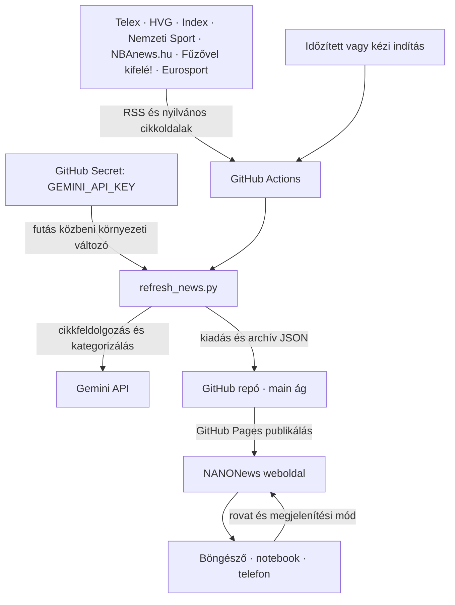
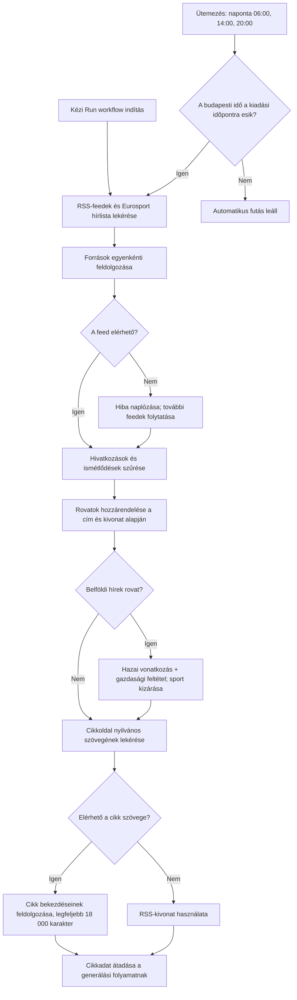
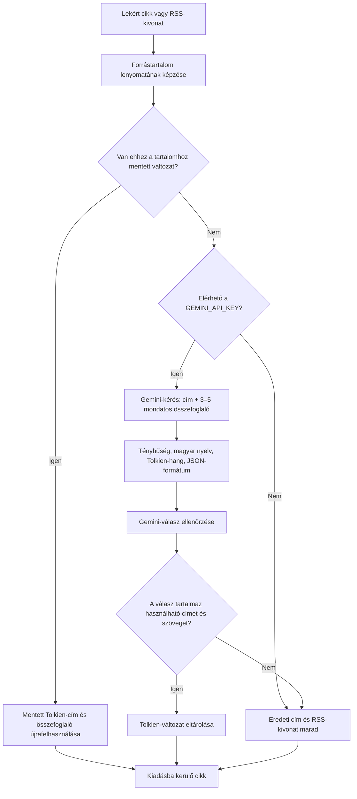
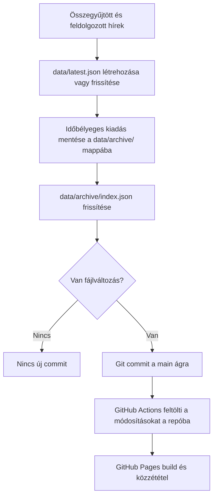
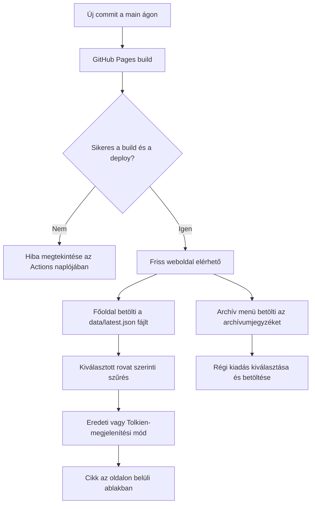

# NANONews – működési és rendszerleírás

Utolsó frissítés: 2026-11-23  
A leírás a repó aktuális működését dokumentálja. A jövőbeni felhasználói kéréseket és az azok alapján végzett módosításokat minden alkalommal rögzíteni kell a dokumentum Változásnapló részében, a munka után pedig az állapotot, az érintett fájlokat és az ellenőrzés eredményét is fel kell jegyezni. Titkot, jelszót vagy API-kulcsot soha nem szabad ebbe vagy más repóban tárolt fájlba írni.

## 1. A rendszer célja

A NANONews magyar nyelvű, személyre szabható, régi újságot idéző digitális hírkiadás. A mobilon és számítógépen is megnyitható GitHub Pages weboldal a legfrissebb kiadást mutatja, és a korábbi számok az Archív lapok lenyitható listájából visszanézhetők.

Az oldal jelenleg statikus webalkalmazás. Nincs külön SQL-adatbázis vagy saját szerver: a friss hírek és az archív példányok JSON-fájlokként a GitHub-repóban tárolódnak. A repó nyilvános, ezért a weboldal, a cikk-metaadatok és az archivált kiadások bárki számára elérhetők.

## 2. Ingyenes összetevők és integrációk

| Összetevő | Feladat | Költségkezelés |
| --- | --- | --- |
| GitHub Pages | A statikus oldal közzététele a NANONews webcímen | A jelenlegi nyilvános repóval ingyenes használatra van beállítva |
| GitHub Actions | RSS-lekérés, cikkoldalak feldolgozása, kiadás- és archívumfájlok készítése, commit | A workflow nem használ fizetős külső ütemezőt vagy szervert |
| Google AI Studio / Gemini API | Tolkien-hangú cím és összefoglaló készítése | A projekt ingyenes keretű használatra van beállítva; nincs fizetős tartalék |
| Hírforrások RSS-ei és nyilvános cikkoldalai | Cím, kivonat, cikk-szöveg és esetenként kép adatforrása | Nyilvánosan elérhető tartalom feldolgozása; fizetőfal vagy belépés megkerülése nélkül |

A szolgáltatók ingyenes keretei és használati korlátai változhatnak. Ha egy ingyenes kvóta kimerül, az AI-átfogalmazás elmaradhat; a rendszer nem áll át automatikusan fizetős szolgáltatásra. A Google AI Studio-ban a kulcs a Free tier projekthez tartozik. A fizetős számlázást nem szabad bekapcsolni a NANONews működtetéséhez.

### Rendszerarchitektúra

Az adatfeldolgozás ütemezetten vagy kézi indítással történik. A GitHub Actions futtatja a Python-feldolgozót, a Gemini API-kulcsot GitHub Secretből kapja meg, a kimeneti JSON-fájlok pedig a repóba kerülnek. A GitHub Pages ezekből szolgálja ki az oldalt számítógépen és mobilon.

Az API-kulcs csak a workflow futásakor jut el a feldolgozóhoz, és a generálásnál kerül tovább a Gemini API-hoz. A böngésző nem kapja meg a kulcsot.

## 3. Források

A források és lekérési módok a refresh_news.py fájlban vannak beállítva:

- Telex — https://telex.hu/rss
- HVG — https://hvg.hu/rss
- Index — https://index.hu/rss
- Nemzeti Sport — elsődlegesen https://www.nemzetisport.hu/publicapi/hu/rss/nso/articles
- Nemzeti Sport tartalék feed — https://www.nemzetisport.hu/static/rss_hirek.xml
- NBAnews.hu — https://nbanews.hu/feed/
- Fűzővel kifelé! — https://fuzovelkifele.com/feed/ (WordPress RSS; NFL-cikkek)
- Eurosport — https://www.eurosport.hu/latest-news.shtml (a legfrissebb hírek nyilvános cikklistájának feldolgozása; hivatalos RSS-feed nem állt rendelkezésre)

A nem elérhető RSS-végpont vagy hírlista hibáját a workflow naplózza, a többi forrást ettől még feldolgozhatja. A Eurosport legfrissebb hírek listáját minden kiadáskor lekéri, abból a cikkcímeket és hivatkozásokat dolgozza fel, majd a cikkoldalak nyilvánosan elérhető szövegét próbálja letölteni. A forrás neve minden cikk mellett megjelenik. A cikk címe és RSS-kivonata alapján történik a témába sorolás; a teljes cikk szövegét a generálás számára próbálja elérni a rendszer, ha az nyilvánosan olvasható.

## 4. Rovatok és szűrés

A megjelenő rovatmenü az index.html fájl topics listájában van. A gyűjtő- és témaszabályok a refresh_news.py fájl rules listájában, valamint a Belföldi hírek külön osztályozójában találhatók.

Jelenlegi rovatok:

- Arsenal
- Manchester City
- Bayern München
- Manchester United
- Como
- Premier League
- F1
- NBA
- NFL
- Seattle Seahawks
- Kerékpár
- Belföldi parlament
- Belföldi tőzsde
- Külföldi tőzsde
- Belföldi hírek

A Belföldi hírek rovat kizárólag olyan híreket jeleníthet meg, amelyek magyarországi vagy magyar vonatkozásúak, gazdasági témát tartalmaznak, és nem sporthírek. A feldolgozó gazdasági kulcsszókat és hazai vonatkozásra utaló kifejezéseket vizsgál; sportrovatba sorolt cikket vagy sportkifejezéseket tartalmazó hírt kizár. A weboldal ugyanezt a szűrést alkalmazza az archív kiadások megjelenítésekor is, ezért a korábbi, tágabb szabály szerint elmentett sporthírek sem kerülnek be a Belföldi hírek rovatba.

A rovatok bővítésekor a rovat feliratát az index.html fájlban, a begyűjtési szabályt pedig a refresh_news.py fájlban kell frissíteni. A történeti adatokban elmentett kategóriák miatt a felületi szűrést is felül kell vizsgálni.

## 5. Kiadásrend és ütemezés

A .github/workflows/refresh.yml GitHub Actions workflow naponta három tervezett kiadást készít:

- 06:00
- 14:00
- 20:00

Az időzóna Europe/Budapest. A GitHub UTC-alapú cronja mind a téli, mind a nyári időszámítást lefedi; a Python program ellenőrzi a helyi budapesti órát, és csak a fenti időpontok valamelyikében készít automatikus kiadást. A GitHub Actions indítása néha késhet, ezért az ütemezés tervezett időpont, nem másodpercre garantált futás. A workflow kézzel is indítható a repó Actions → Refresh NANONews → Run workflow felületén; a kézi indításnál az időkorlát ellenőrzése nem állítja le a futást.

## 6. Hírek feldolgozásának folyamata

1. A GitHub Actions elindítja a refresh.yml workflow-t, és lekéri a repót.
2. A refresh_news.py beolvassa a források RSS-feedjeit, kiszűri az ismétlődő hivatkozásokat, majd a cím és a kivonat alapján témákat rendel a hírekhez.
3. A program megpróbálja lekérni a cikkoldal nyilvánosan elérhető törzsszövegét. A feldolgozó a cikk bekezdéseit keresi, és legfeljebb 18 000 karaktert használ fel. Ha a cikk nem érhető el vagy nincs elegendő nyilvános szöveg, az RSS-kivonat lesz az alapanyag.
4. A forrás tartalmának lenyomata alapján ellenőrzi, hogy az adott változat már elkészült-e. Változatlan cikkek meglévő Tolkien-változatát újra felhasználja, hogy ne kérjen feleslegesen új generálást.
5. Ha van használható Gemini-kulcs, a program címet és 3–5 mondatos összefoglalót kér. A prompt előírja a tények megtartását, az új tények és fantasy-elemek tiltását, valamint a JSON-választ.
6. A program létrehozza vagy frissíti a data/latest.json fájlt, hozzáad egy időbélyeges kiadást a data/archive/ mappához, majd frissíti a data/archive/index.json archívumjegyzéket. Legfeljebb 80 cikk kerül egy kiadásba.
7. Sikeres fájlváltozás esetén a workflow commitolja az adatfájlokat a main ágra. A GitHub Pages a repó új állapotából közzéteszi a friss oldalt.

### Folyamatábrák

#### Kiadás indítása és hírgyűjtés

A feedhiba nem állítja le a többi forrás feldolgozását. A kézi indításnál az időzítési ellenőrzés kimarad; automatikus indításnál csak a megfelelő budapesti időablak folytatódik.

#### Eredeti összefoglaló és Tolkien-változat

A generálás a nyilvánosan elérhető cikk szövegét használja, ha az lekérhető; különben az RSS-kivonatot. Az eredeti és a Tolkien-változat külön mezőkben marad meg, ezért a weboldal választója a címet és az összefoglalót együtt tudja váltani.

#### Kiadás mentése és feltöltése a repóba

#### Publikálás és megjelenítés

A GitHub Actions futás sikeressége és a Pages közzététele külön állapot. A frissítés akkor tekinthető teljesnek, ha az adatfájlok commitja megvan, a Pages build/deploy sikeres, és az élő oldalon az új kiadás megjelenik.

## 7. AI-generálás és megjelenítési módok

Az oldal két módot kínál:

- Eredeti: a forrás eredeti címe és rövid kivonata.
- Tolkien: a Gemini által létrehozott új cím és a forrás alapján írt, részletes, 3–5 mondatos összefoglaló.

A generált változat a hír mellett és a cikket az oldalon belül megnyitó ablakban is megjelenik. A felhasználó nem navigál el a NANONews oldaláról a forrásra. A generált szöveg összefoglaló; nem a teljes cikk újramondása vagy másolata. A cikkfotó, ha a feed szolgáltat képet, nyomdai hatású, egyszerűsített képként jelenik meg.

A Gemini-változat mezői a kiadás JSON-jában a variants.tolkien.title és variants.tolkien.body alatt vannak. Ha egy cikkhez nem sikerül generálni, a felület az eredeti címet és kivonatot jeleníti meg. Így egy forráshiba nem akadályozza a teljes kiadás megjelenítését.

A generálás jelenlegi modellje a kódban gemini-3.5-flash-lite, az API-hívás a Google Interactions API v1beta végpontjára megy. A modell- és végpontbeállítás a refresh_news.py fájlban módosítható.

## 8. API-kulcsok és titokkezelés

A Gemini API-kulcs a Google AI Studio-ban jön létre. A kulcs értéke kizárólag a GitHub Actions titokkezelőjébe kerülhet, a repóban GEMINI_API_KEY néven. A .github/workflows/refresh.yml a titkot futáskor környezeti változóként adja át a refresh_news.py programnak.

A kulcs biztonságos útja:

1. Google AI Studio: a Free tier projekthez API-kulcs készül.
2. GitHub repó: Settings → Secrets and variables → Actions → Repository secrets.
3. A titok neve GEMINI_API_KEY; a GitHub titkosítva tárolja.
4. A workflow futásakor a kulcs környezeti változóként érhető el a Python-folyamat számára.
5. A generálási kérések az x-goog-api-key fejlécen adják át a kulcsot a Google API-nak.
6. A kulcs nem kerülhet JSON-kiadásba, HTML-be, naplóba, commitba, képernyőképbe vagy dokumentumba.

Ha a kulcs cserére szorul, új kulcsot kell létrehozni, a GitHub Actions titok értékét frissíteni, majd egy kézi workflow-futtatással ellenőrizni a működést. A régi kulcs visszavonása előtt meg kell győződni arról, hogy nem használja-e más projekt vagy integráció. Ne kérj és ne fogadj API-kulcsot chatüzenetben; ne jelenítsd meg a vágólap vagy az űrlap értékét ellenőrzéskor.

## 9. Weboldal és archívum

A főoldal a data/latest.json fájlt tölti be, cache nélküli lekéréssel. A hírek újságszerű hasábokban jelennek meg, a kiválasztott rovat szűri a teljes tartalmat. A rovatok témacsoportokba rendezve jelennek meg: a sportrovatok az első sorban, a többi rovat a következő sorban. Kis képernyőn a csoportokon belüli elemek további sorokba törnek.

A megjelenítési mód és a kiválasztott rovat a böngésző helyi tárolójában marad meg, nem szerveroldali felhasználói profilban. Az Archív lapok egy lenyitható, legfrissebbtől legrégebbiig rendezett listában jelennek meg; egy régi szám kiválasztásakor az oldal annak a kiadásnak a JSON-fájlját tölti be.

A weboldal nyilvános elérhetősége: https://ngynrbrt-prog.github.io/nanonews/

## 10. Hibakezelés és korlátok

- Egy hibás RSS-feed nem akadályozza meg a többi forrás lekérését.
- Ha a forrásoldal 404/503 hibát ad, vagy a cikk szövege nem olvasható, a cikk kimaradhat a kiadásból, vagy az RSS-kivonat lehet az alapanyag.
- Ha a Gemini API hibát ad, a kvóta kimerült, vagy a válasz nem megfelelő JSON, az adott hírhez nem biztos, hogy létrejön Tolkien-változat. Az eredeti szöveg megmarad.
- A GitHub Actions vagy Pages késése késleltetheti az új kiadás közzétételét.
- A GitHub Pages nyilvános; ne tárolj benne személyes adatot vagy hozzáférési tokent.
- A rendszer jelenleg fájlalapú. A Git-repó tölti be a kiadás-adattár szerepét; külön adatbázis-integráció nincs beállítva.

## 11. Módosítások és publikálás

Kód- vagy rovatváltoztatáskor az érintett forrásfájlokat a main ágra kell menteni. A weboldal működésének része lehet az index.html, refresh_news.py, .github/workflows/refresh.yml, README.md és a data/ kiadási adatai.

Módosítás után ellenőrizendő:

1. A változás a megfelelő GitHub-fájlban szerepel-e.
2. A GitHub Actions workflow lefutott-e, és sikeres-e.
3. Sikeres frissítésnél változott-e a data/latest.json és készült-e archív példány.
4. A GitHub Pages közzétette-e a friss HTML-t és adatokat.
5. A Tolkien mód és a megfelelő rovat működik-e az élő oldalon.

A helyi tesztek futtatása csak külön kérésre történik; a publikált oldal és a workflow állapotának ellenőrzése ettől független működés-ellenőrzés.

## 12. Változásnapló

### 2026-11-23 — dokumentáció és alapfolyamat
- Rögzítve az ingyenes GitHub Pages + GitHub Actions + Google AI Studio felépítés, a feedek, az archívum, az ütemezés és a titokkezelés.
- Gemini API-kulcs a GitHub Actions GEMINI_API_KEY titokban van tárolva; a generálási workflow sikeresen lefutott.
- Az új kiadásban 41 hír készült, ebből 38-hoz Tolkien-cím és összefoglaló állt rendelkezésre; három cikkhez forrásoldali hiba miatt nem készült átírás.
- Ellenőrizve: a Tolkien mód a kártyacímeket és a megnyitott cikk címét, valamint az összefoglalót is átváltja.

### 2026-11-23 — Belföldi hírek rovat gazdasági szűrése
- Kérés: a Belföldi hírek rovat kizárólag gazdasági híreket tartalmazzon, sportot ne.
- Módosítva: refresh_news.py hazai + gazdasági + sportkizáró feltételei; index.html ugyanilyen szűrése az új és archív kiadásokra.
- Ellenőrzés: a kézi frissítési futás (#10) sikeresen lezárult; a 12:06-os kiadás 31 cikket tartalmaz, mind a 31-hez készült Tolkien-változat. A Belföldi hírek kategóriában 4 gazdasági hír szerepel; sportkategóriájú cikk nem került bele.
- Közzététel: a főoldalon a rovat kiválasztásakor ellenőriztem, hogy sportcikkek nem jelennek meg.
- További felületi pontosítás: a fejléc most mindhárom kiadási időt mutatja; eltávolítva az elavult „első kiadás készül / adatbázis bekötése szükséges” üzenet. A módosítás közzétéve; az élő oldalon megerősítettem a napi három időpontot és az elavult üzenet eltávolítását.

### 2026-11-23 — Fűzővel kifelé!, Eurosport és sportrovatrendezés
- Kérés: rendszeresen lekérni a Fűzővel kifelé! és Eurosport portált; NFL és Seattle Seahawks rovatot, valamint Kerékpár rovatot felvenni; a sportrovatokat az első sorba, az egyéb rovatokat külön sorba rendezni. A Belföldi parlament a nem sportos rovatok közé került.
- Módosítva: refresh_news.py a Fűzővel kifelé! RSS-ével (NFL-kategóriába sorolva) és a Eurosport legfrissebb hírek listájának lekérésével; index.html NFL, Seattle Seahawks és Kerékpár rovatával, valamint két soros rovatcsoportjaival.
- A Eurosport magyar oldalon nem találtam hivatalos RSS-végpontot; a nyilvános /latest-news.shtml oldalból a cikkcímek és cikkhivatkozások kerülnek feldolgozásra.
- Ellenőrzés: a Fűzővel kifelé! feed a böngészőben elérhető volt, RSS-elemeket, nyilvános cikk-szöveget és képeket adott. A Eurosport legfrissebb hírek oldala böngészőben ellenőrizve. Az első kézi kiadás sikeres lett, de az Actions HTML-listázója nem talált linket; a parser most az `aria-label` címet is feldolgozza. A Google News RSS próbát automatikus lekérés blokkolta, ezért nem erre épül a rendszer. Az új parserrel még egy frissítés szükséges a működés igazolásához.
- Mermaid-megjelenítés: a publikálási folyamatábrában a fenntartott „style” azonosító „mode”-ra javítva.

### 2026-11-23 — működési dokumentáció folyamatábrái
- Kérés: architektúra-ábra és részletes folyamatábrák a gyűjtéshez, összefoglalóhoz, Tolkien-módhoz, kiadásmentéshez és publikáláshoz.
- Elkészült: Mermaid-ábrák kerültek a működési leírás megfelelő fejezeteibe; külön jelölve az automatikus és kézi indítás, a feedhiba, a cikk/RSS-tartalom választása, a kulcs használata, az archívum mentése, a GitHub-commit és a Pages deploy.
- Állapot: feltöltve a main ágra; a dokumentum GitHub Markdown előnézetében ellenőrizve.

### 2026-11-23 — Seattle Seahawks rovat és rovatcsoportok
- Kérés: Seattle Seahawks külön rovatként jelenjen meg a sportos rovatcsoportban; a Belföldi parlament maradjon a második, nem sportos csoportban.
- Ellenőrizve a közzétett forrásban: a Seattle Seahawks gomb a sportos csoporthoz van rendelve, a Belföldi parlament és a többi nem sportos rovat a második csoportban jelenik meg. A Seattle Seahawks kulcsszavas szűrése a hírgyűjtésnél és az oldalon is be van állítva; sporthírként a Belföldi hírekből is kizáródik.
- A megjelenítéshez nem szükséges fizetős szolgáltatás.

### 2026-11-23 — frissítési idő és cikkek megjelenési ideje
- Kérés: a kiadás frissítési időpontja üres rovatnál is maradjon látható; minden cikk alján jelenjen meg a forrás szerinti megjelenési idő.
- Módosítva az index.html: a „FRISSÍTVE” időpont beállítása a rovat szerinti szűrés előtt történik, ezért találat nélküli rovatnézetben sem tűnik el. A kiválasztott régi archív kiadás saját frissítési idejét mutatja.
- Módosítva az index.html: a főcikk, a rovatcikk-kártyák és a cikken belüli ablak alján megjelenik a forrás RSS-ében lévő publikálási dátum és idő. Ha a forrás nem ad meg vagy nem értelmezhető időpontot, a felület ezt jelzi, nem állít be kitalált értéket.

### Következő módosítások
- Minden további felhasználói kérést dátummal kell felvenni a naplóba, és a lezáráskor frissíteni kell az érintett fájlok és a siker/hibák állapotát.
