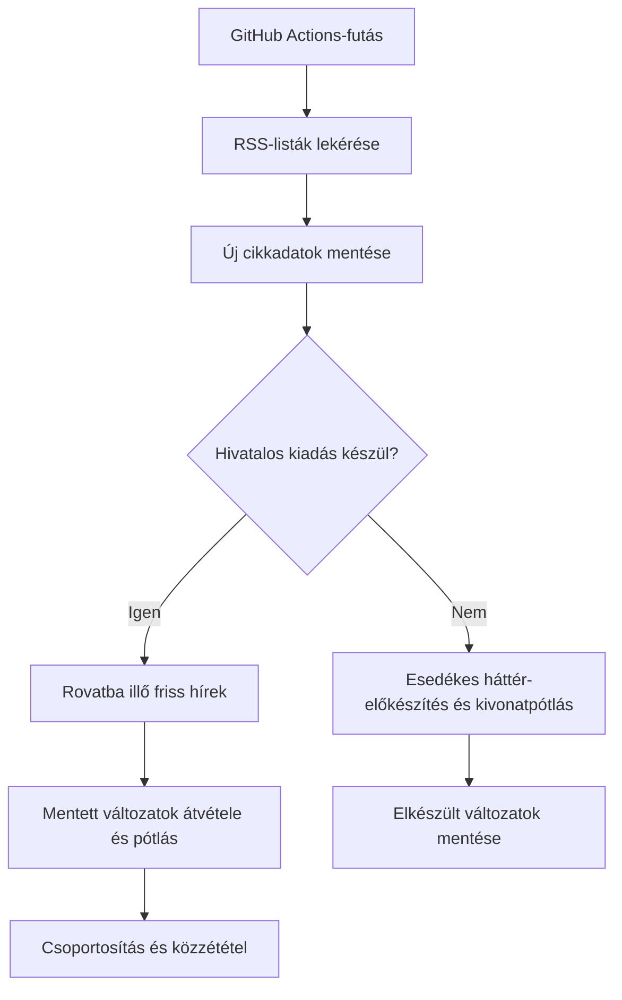
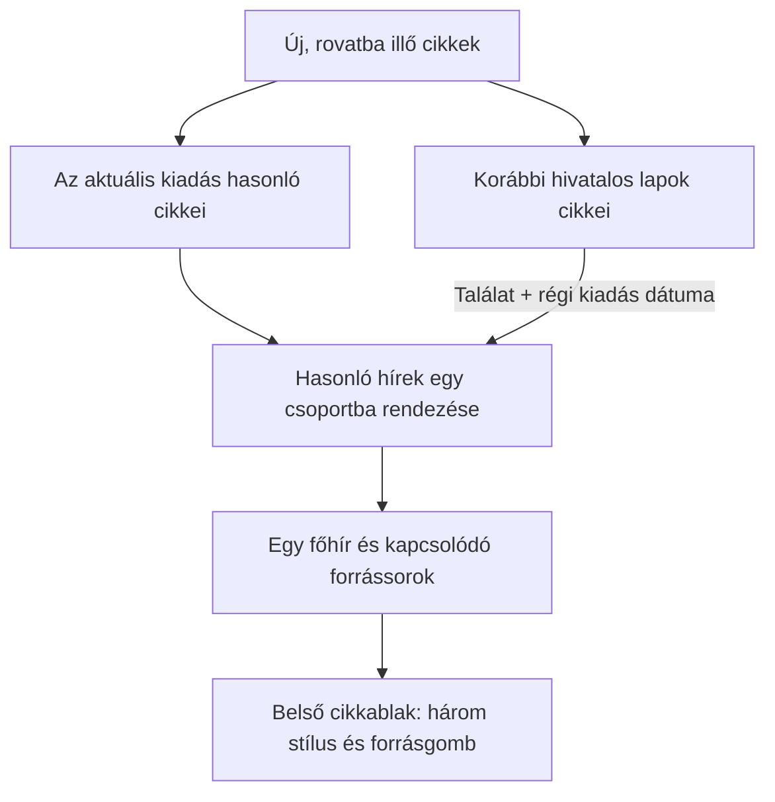
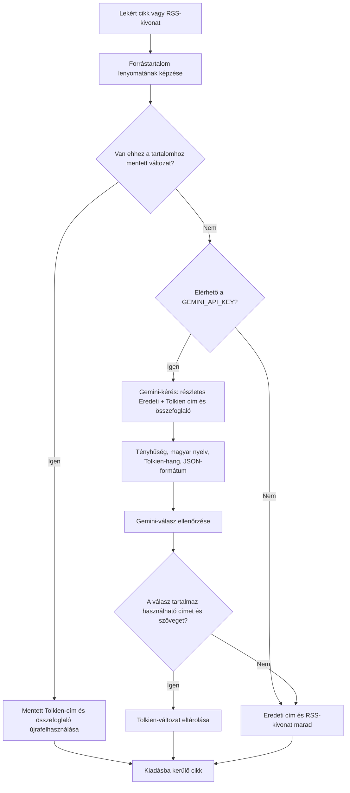
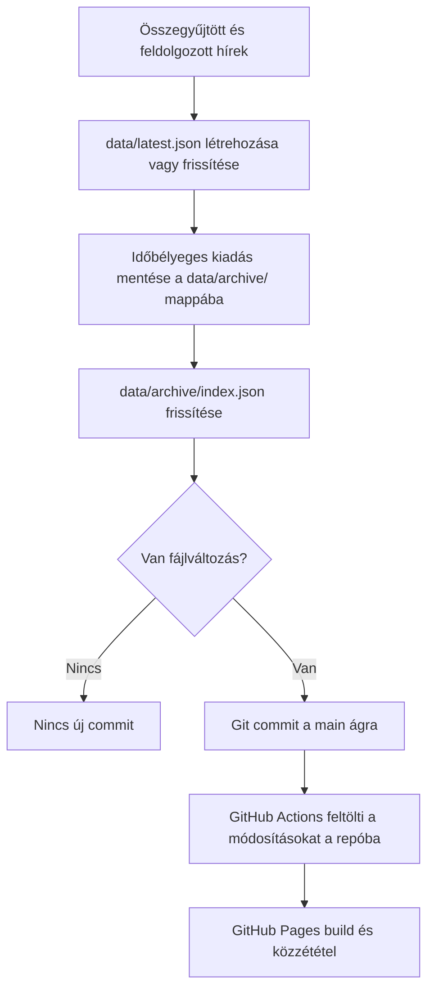
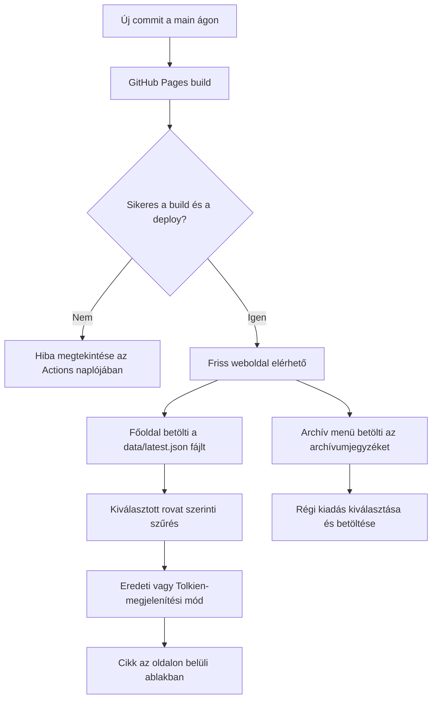

# NANONews – működési és rendszerleírás

Utolsó frissítés: 2026-11-23  
A leírás a repó aktuális működését dokumentálja. A jövőbeni felhasználói kéréseket és az azok alapján végzett módosításokat minden alkalommal rögzíteni kell a dokumentum Változásnapló részében, a munka után pedig az állapotot, az érintett fájlokat és az ellenőrzés eredményét is fel kell jegyezni. Titkot, jelszót vagy API-kulcsot soha nem szabad ebbe vagy más repóban tárolt fájlba írni.

## 1. A rendszer célja

A NANONews magyar nyelvű, személyre szabható, régi újságot idéző digitális hírkiadás. A mobilon és számítógépen is megnyitható GitHub Pages weboldal a legfrissebb kiadást mutatja, és a korábbi számok az Archív lapok lenyitható listájából visszanézhetők.

Az oldal jelenleg statikus webalkalmazás. Nincs külön SQL-adatbázis vagy saját szerver: a friss hírek és az archív példányok JSON-fájlokként a GitHub-repóban tárolódnak. A repó nyilvános, ezért a weboldal, a cikk-metaadatok és az archivált kiadások bárki számára elérhetők.

## 2. Ingyenes összetevők és integrációk

| Összetevő | Feladat | Költségkezelés |
| --- | --- | --- |
| GitHub Pages | A statikus oldal közzététele a NANONews webcímen | A jelenlegi nyilvános repóval ingyenes használatra van beállítva |
| GitHub Actions | RSS-lekérés, cikkoldalak feldolgozása, kiadás- és archívumfájlok készítése, commit | A workflow nem használ fizetős külső ütemezőt vagy szervert |
| Google AI Studio / Gemini API | Tolkien-hangú cím és összefoglaló készítése | A projekt ingyenes keretű használatra van beállítva; nincs fizetős tartalék |
| Hírforrások RSS-ei és nyilvános cikkoldalai | Cím, kivonat, cikk-szöveg és esetenként kép adatforrása | Nyilvánosan elérhető tartalom feldolgozása; fizetőfal vagy belépés megkerülése nélkül |

A szolgáltatók ingyenes keretei és használati korlátai változhatnak. Ha egy ingyenes kvóta kimerül, az AI-átfogalmazás elmaradhat; a rendszer nem áll át automatikusan fizetős szolgáltatásra. A Google AI Studio-ban a kulcs a Free tier projekthez tartozik. A fizetős számlázást nem szabad bekapcsolni a NANONews működtetéséhez.

### Rendszerarchitektúra

Az adatfeldolgozás ütemezetten vagy kézi indítással történik. A GitHub Actions futtatja a Python-feldolgozót, a Gemini API-kulcsot GitHub Secretből kapja meg, a kimeneti JSON-fájlok pedig a repóba kerülnek. A GitHub Pages ezekből szolgálja ki az oldalt számítógépen és mobilon.

Az API-kulcs csak a workflow futásakor jut el a feldolgozóhoz, és a generálásnál kerül tovább a Gemini API-hoz. A böngésző nem kapja meg a kulcsot.

## 3. Források

A források és lekérési módok a refresh_news.py fájlban vannak beállítva:

- Telex — https://telex.hu/rss
- HVG — https://hvg.hu/rss
- Nemzeti Sport — elsődlegesen https://www.nemzetisport.hu/publicapi/hu/rss/nso/articles
- Nemzeti Sport tartalék feed — https://www.nemzetisport.hu/static/rss_hirek.xml
- NBAnews.hu — https://nbanews.hu/feed/
- Fűzővel kifelé! — https://fuzovelkifele.com/feed/ (WordPress RSS; NFL-cikkek)
- 444.hu — https://444.hu/feed/
- Portfolio.hu — https://www.portfolio.hu/rss/all.xml
- Origo.hu — https://www.origo.hu/publicapi/hu/rss/origo/articles

A nem elérhető RSS-végpont hibáját a workflow naplózza, a többi feed feldolgozása ettől még folytatódik. A cikkcímeket, hivatkozásokat, kivonatokat és képeket az RSS-feedekből dolgozza fel, majd megpróbálja letölteni a nyilvánosan olvasható cikk szövegét. A forrás neve minden cikk mellett megjelenik. A témába sorolás a cikk címe és RSS-kivonata alapján történik.
## 4. Rovatok és szűrés

A megjelenő rovatmenü az index.html fájl topics listájában van. A gyűjtő- és témaszabályok a refresh_news.py fájl rules listájában, valamint a Belföld rovat osztályozójában találhatók.

Jelenlegi rovatok:

- Bajnokok ligája
- Premier League
- Arsenal
- Bayern München
- Manchester United
- Como
- F1
- NBA
- NFL
- Seattle Seahawks
- Kerékpár
- Darts
- Belföld
- Tőzsde (belföldi és külföldi tőzsde egy rovatban)
- Technológia / Fejlesztések
- Környezetvédelem (2026. november 24-i délutáni számtól)
- Filmek (2026. november 24-i délutáni számtól)

A Technológia / Fejlesztések rovat a technológiai híreket, szoftvereket és alkalmazásokat, mesterséges intelligenciát, kiberbiztonságot, digitális fejlesztéseket és újításokat gyűjti. A cím- és RSS-kivonat kulcsszavai alapján sorolja be a híreket.

A Belföld rovat a parlamenti témákat, a hazai gazdasági híreket, valamint a NER-hez és a megnevezett hazai politikai szereplőkhöz kapcsolódó cikkeket jeleníti meg. Az általános sporthírek kizáródnak, de a magyar sport gazdasági témái bekerülhetnek.

Az NFL rovat kizárólag amerikaifutball-híreket mutat. Az „NFL” rövidítést teljes szóra illesztve keresi a rendszer, hogy például az „influenszer” vagy „konfliktus” szó belső betűsora ne okozzon téves besorolást. A Fűzővel kifelé! feedje NFL-forrásként kezelt; más forrásból csak amerikaifutball-szakkifejezés vagy konkrét liga-/csapatnév alapján kerülhet be cikk.

A Tőzsde rovat egyesíti a hazai és a külföldi részvénypiaci híreket. A Környezetvédelem rovat környezeti, természetvédelmi és klímavédelmi témákat; a Filmek rovat mozi- és filmes híreket gyűjt. Ezek a menüpontok a 2026. november 24-i 17:00-s szám előtt nem jelennek meg.

Az NVIDIA/Jensen Huang körüli, azonos vezérigazgatói visszatérési és részvénypiaci eseményről szóló cikkeket a cég, a szereplő és az esemény közös jelzései alapján is összekapcsolja a hasonlósági logika, még akkor is, ha a címek szókészlete eltér.

A rovatok bővítésekor a rovat feliratát az index.html fájlban, a begyűjtési szabályt pedig a refresh_news.py fájlban kell frissíteni. A történeti adatokban elmentett kategóriák miatt a felületi szűrést is felül kell vizsgálni.

## 5. Kiadásrend és ütemezés

A `.github/workflows/refresh.yml` óránként a :02, :07, :12, …, :57 percekre ütemezi az ellenőrzést. A GitHub Actions tényleges indítása késhet. A workflow egyszerre egy feldolgozást futtat. A hivatalos kiadások a 06:00–06:59-es (/1) és a 17:00–17:59-es (/2) idősávban készülnek, Europe/Budapest szerint. Idősávonként legfeljebb egy hivatalos szám készül. Kézi futás a repó Actions → Refresh NANONews → Run workflow felületén indítható.

| Művelet | Ütemezés |
|---|---|
| RSS-lekérés mind a nyolc forrásból | Minden futáskor |
| Portfolio.hu előkészítése | Az első olyan kiadások közötti futásban, amely a rovatba illő cikket eléri. Sikertelen előkészítés után a következő háttérpróba legalább egy óra múlva esedékes |
| A többi hét forrás előkészítése | Az előző közös kör után legalább öt órával, az első megfelelő háttérfutásban |
| Hiányzó változatok pótlása a legfrissebb számban | Kiadások közötti futáskor, futásonként legfeljebb három érintett cikknél |
| Hivatalos lapszám készítése | Az első megfelelő futásban a reggeli vagy délutáni idősávban |

## 6. Hírek feldolgozásának folyamata

1. A `refresh_news.py` minden futáskor lekéri a Telex, HVG, Nemzeti Sport, NBAnews.hu, Fűzővel kifelé!, 444.hu, Portfolio.hu és Origo.hu RSS-listáit. A begyűjtött cikkadatokat a `data/rss-pending.json` őrzi a kiadások között. Az RSS-ből időközben kieső cikk megmarad, ha egy korábbi sikeres futás már látta. Egy forrás hibáját a workflow naplózza, és továbblép a következő forrásra.
2. A gyűjtő kiszűri a már kiadott hivatkozásokat. Az új számba a legutóbbi hivatalos kiadás után, az aktuális futás kezdetéig megjelent és valamelyik rovatba illő hírek kerülhetnek. A besorolás alapja a cím, az RSS-kivonat és a hivatkozás. Az NBAnews.hu automatikusan NBA, a Fűzővel kifelé! automatikusan NFL besorolást is kap.
3. Előkészítéskor a rendszer lekéri a nyilvánosan elérhető cikkoldalt. A feldolgozás legfeljebb 18 000 karakternyi törzsszöveget vesz alapul, szükség esetén az RSS-kivonatból dolgozik. A Gemini egy kérésben készíti el az Eredeti összefoglalót, a Tolkien tollából és a Rejtő Jenő változatot. A kivonatok célhossza 3–4 mondat, legfeljebb 1400 karakter változatonként.
4. A három elkészült változatot a gyűjtő a cikk mellett menti. Kiadáskor az aktuális generálási beállításhoz illeszkedő, változatlan cikkhez tárolt csomagot újra felhasználja. A még hiányzó változatokhoz megpróbál összefoglalót készíteni. Ha a szolgáltatás nem érhető el vagy kimerül a kvóta, a felület az elérhető kivonatot mutatja, és jelzi a függőben lévő átfogalmazást.
5. A kiadás időrendbe rendezi a híreket, csoportosítja a hasonló témájú cikkeket, és kapcsolódó archív híreket keres. A kiadás darabszámkorlát nélkül menti az összes kiválasztott hírcsoportot. Ha egy hivatalos futás nem talál megfelelő új hírt, a legutóbbi kiadás marad a felületen.
6. A workflow a megváltozott adatfájlokat a főágra menti. A felület a `data/latest.json` és a kiadások archív adatfájljai alapján jeleníti meg a lapszámokat. A háttérben előkészített cikkek és kivonatok a rendes kiadás részeként jelennek meg a felületen.

### Folyamatábrák

#### Kiadás indítása és hírgyűjtés

#### Hasonló hírek, archív összekapcsolással

A csoportosítás egy kapcsolódó cikkcsoportba rendezi az azonos eseményről szóló friss híreket, és minden cikk megtartja saját kivonatait és forráslinkjét. A cím és a kivonat szavainak egyezése mellett a Jensen Huanggal kapcsolatos NVIDIA-híreket külön szabály is összeköti. A rovatszámláló az adott rovathoz tartozó egyedi friss cikkeket számolja, a kapcsolódó friss cikkeket is beleértve. Az **Archív lapok** lenyitható listája a hivatalos kiadásokat mutatja időrendben, a tesztlapokat elrejti. A dátum melletti aznapi kiadásválasztó külön felületi elem, ott a rendelkezésre álló tesztkiadások Teszt jelöléssel megjelenhetnek.

Az új hivatalos kiadásba kerülő cikkeket a feldolgozó a 444.hu, a Portfolio.hu, az Origo.hu és a többi forrás friss cikkeivel hasonlósági alapon összeveti. A cím- és kivonatszavak alapján talált, eltérő forrásból származó hírek egy főhírhez kapcsolódnak; az archívum feldolgozása minden korábbi hivatalos lapszám cikkeire kiterjed. Az archív találat sorában a forrás neve mellett az „arch.” és az eredeti kiadás dátuma látszik.

A hasonló hír sorára kattintva az olvasó a NANONews oldalon belüli cikkablakban látja a címet, a hosszabb összefoglalót és az Eredeti, Tolkien vagy Rejtő Jenő változatot. A cikkablak alján található Forrás gomb visz az eredeti cikkoldalra. Az archív lapok nem módosulnak, és egy régi cikk nem kerül vissza új kiadás főhírlistájára.

#### Eredeti összefoglaló és Tolkien-változat

A generálás a nyilvánosan elérhető cikk szövegét használja, ha az lekérhető; különben az RSS-kivonatot. Az Eredeti, Tolkien és Rejtő változat külön mezőkben tárolódik, ezért a választó a címet és az összefoglalót együtt váltja.

#### Kiadás mentése és feltöltése a repóba

#### Publikálás és megjelenítés

A GitHub Actions futás sikeressége és a Pages közzététele külön állapot. A frissítés akkor tekinthető teljesnek, ha az adatfájlok commitja megvan, a Pages build/deploy sikeres, és az élő oldalon az új kiadás megjelenik.

## 7. AI-generálás és megjelenítési módok

A felület két, egymástól elkülönített beállításcsoportot kínál:

- **Írás stílusa:** Eredeti, Tolkien tollából vagy Rejtő Jenő stílus. A választás a hírek címére és összefoglalójára is érvényes.
- **Éjszakai mód:** önálló be/ki kapcsoló a fejléc közepén, a napi dátummal egy sorban, közvetlenül a NANONews cím fölött. Bekapcsolva az egész oldal sötét színtémára vált; az állapot kikapcsolásig és oldalfrissítés után is megmarad.

Az Írás stílusa két gombja közvetlenül a NANONews logó alatt jelenik meg, a korábbi „A nap, egy másik hasábban.” jelmondat helyén. A gombok a logóval együtt a sticky fejlécblokk részei; külön, rögzített alsó sáv nincs. Csak az Archív lapok és a Rovataim maradnak összecsukható panelek. Asztali nézetben a fejlécben a „Budapest · személyes Napközbeni lap” balra, az éjszakai kapcsoló középre, a dátum és az aznapi kiadásválasztó jobbra rendeződik; mobilon középre rendezve a városnév, a dátumválasztó sor, majd a kisebb éjszakai kapcsoló következik. A dátum melletti natív legördülő lista az adott nap összes elkészült lapját mutatja lapszám és futási idő szerint; egy korábbi szám kiválasztásakor az oldal betölti annak archív példányát. A 06:00-s lap /1, a 17:00-s /2; az archív korábbi dátumok meglévő lapszámai megmaradnak. Az éjszakai kapcsoló nincs az írásstílus választóval egy sorba rendezve, és a sötét téma mellett is használható mindkét írásstílus. A generált változat a hír mellett és a cikket az oldalon belül megnyitó ablakban is megjelenik. A felhasználó nem navigál el a NANONews oldaláról a forrásra. A generált szöveg összefoglaló; nem a teljes cikk újramondása vagy másolata. A cikkfotó, ha a feed szolgáltat képet, nyomdai hatású, egyszerűsített képként jelenik meg.

A kiadás JSON-jában a tárgyilagos, 2–3 mondatos Eredeti összefoglaló a variants.original.body mezőben, a Tolkien-változat címe és 2–3 mondatos összefoglalója a variants.tolkien.title és variants.tolkien.body mezőkben szerepel. Eredeti stílusban a forrás eredeti címe marad, a hírhez pedig a cikk nyilvánosan elérhető szövegéből készült 2–3 mondatos összefoglaló társul. Ha a generálás nem sikerül vagy nincs API-kulcs, a felület az eredeti címet és legfeljebb három mondatra rövidített RSS-kivonatot jeleníti meg. Így egy generálási hiba nem akadályozza a kiadás megjelenítését.

A 2026. november 24-i 17:00-s kiadástól a Tolkien és Rejtő változatok merészebb, képszerűbb, erőteljesebben felismerhető hangot kapnak; a Tolkien-változat epikusabb és régiesebb ritmust, a Rejtő-változat csattanósabb humort és bátrabb fordulatokat használ. A képek és humor csak a forrásban szereplő tényeket formálhatják át, új eseményt vagy állítást nem tehetnek hozzá. A reggeli kiadás meglévő szövegei változatlanok maradnak. A később újrapróbált hiányzó stílusváltozat a saját kiadása időpontjához igazodik: a 17:00 előtti számok a korábbi, az ettől kezdődő kiadások az új megfogalmazást kapják.\n\nA generálás jelenlegi modellje a kódban gemini-3.5-flash-lite, az API-hívás a Google Interactions API v1beta végpontjára megy. A modell- és végpontbeállítás a refresh_news.py fájlban módosítható.

## 8. API-kulcsok és titokkezelés

A Gemini API-kulcs a Google AI Studio-ban jön létre. A kulcs értéke kizárólag a GitHub Actions titokkezelőjébe kerülhet, a repóban GEMINI_API_KEY néven. A .github/workflows/refresh.yml a titkot futáskor környezeti változóként adja át a refresh_news.py programnak.

A kulcs biztonságos útja:

1. Google AI Studio: a Free tier projekthez API-kulcs készül.
2. GitHub repó: Settings → Secrets and variables → Actions → Repository secrets.
3. A titok neve GEMINI_API_KEY; a GitHub titkosítva tárolja.
4. A workflow futásakor a kulcs környezeti változóként érhető el a Python-folyamat számára.
5. A generálási kérések az x-goog-api-key fejlécen adják át a kulcsot a Google API-nak.
6. A kulcs nem kerülhet JSON-kiadásba, HTML-be, naplóba, commitba, képernyőképbe vagy dokumentumba.

Ha a kulcs cserére szorul, új kulcsot kell létrehozni, a GitHub Actions titok értékét frissíteni, majd egy kézi workflow-futtatással ellenőrizni a működést. A régi kulcs visszavonása előtt meg kell győződni arról, hogy nem használja-e más projekt vagy integráció. Ne kérj és ne fogadj API-kulcsot chatüzenetben; ne jelenítsd meg a vágólap vagy az űrlap értékét ellenőrzéskor.

## 9. Weboldal és archívum

A főoldal a data/latest.json fájlt tölti be, cache nélküli lekéréssel. A hírek újságszerű hasábokban jelennek meg, a kiválasztott rovat szűri a teljes tartalmat. A rovatok témacsoportokba rendezve jelennek meg: a sportrovatok az első sorban, a többi rovat a következő sorban. Kis képernyőn a csoportokon belüli elemek további sorokba törnek. A „KIADÁS FRISSÍTVE” időbélyeg az összes cikk alatt, az Archív lapok fölött jelenik meg; a kiadási idő a rovat szűrésétől függetlenül látható. A rovat melletti [x] darabszám az adott rovatban ténylegesen megjelenő cikkeket számolja, az azonos kiadáson belüli hasonlóhírcsoportok külön cikkeivel együtt; archív összehasonlító híreket nem számol bele.

Az Írás stílusa választása (nanonews-style) és az Éjszakai mód állapota (nanonews-theme) külön kulcson, a böngésző helyi tárolójában marad meg, nem szerveroldali felhasználói profilban. A fejlécben lévő éjszakai kapcsoló oldalbetöltéskor visszaállítja a mentett állapotot, és újabb kattintásig bekapcsolva marad. Az Archív lapok egy lenyitható, legfrissebbtől legrégebbiig rendezett listában jelennek meg; egy régi szám kiválasztásakor az oldal annak a kiadásnak a JSON-fájlját tölti be. A Források és Kiadásrend tájékoztató blokkok az archív lista után, az oldal alján jelennek meg; mobilnézetben egymás alá törnek.

A weboldal nyilvános elérhetősége: https://ngynrbrt-prog.github.io/nanonews/

## 10. Hibakezelés és korlátok

- Egy hibás RSS-feed nem akadályozza meg a többi forrás lekérését.
- Ha a forrásoldal 404/503 hibát ad, vagy a cikk szövege nem olvasható, a cikk kimaradhat a kiadásból, vagy az RSS-kivonat lehet az alapanyag.
- Ha a Gemini API hibát ad, a kvóta kimerült, vagy a válasz nem megfelelő JSON, az adott hírhez nem biztos, hogy létrejön Tolkien-változat. Az eredeti szöveg megmarad.
- A GitHub Actions vagy Pages késése késleltetheti az új kiadás közzétételét.
- A GitHub Pages nyilvános; ne tárolj benne személyes adatot vagy hozzáférési tokent.
- A rendszer jelenleg fájlalapú. A Git-repó tölti be a kiadás-adattár szerepét; külön adatbázis-integráció nincs beállítva.

## 11. Módosítások és publikálás

Kód- vagy rovatváltoztatáskor az érintett forrásfájlokat a main ágra kell menteni. A weboldal működésének része lehet az index.html, refresh_news.py, .github/workflows/refresh.yml, README.md és a data/ kiadási adatai.

Módosítás után ellenőrizendő:

1. A változás a megfelelő GitHub-fájlban szerepel-e.
2. A GitHub Actions workflow lefutott-e, és sikeres-e.
3. Sikeres frissítésnél változott-e a data/latest.json és készült-e archív példány.
4. A GitHub Pages közzétette-e a friss HTML-t és adatokat.
5. A Tolkien mód és a megfelelő rovat működik-e az élő oldalon.

A helyi tesztek futtatása csak külön kérésre történik; a publikált oldal és a workflow állapotának ellenőrzése ettől független működés-ellenőrzés.

## 12. Változásnapló

### 2026-11-24 — archív összehasonlítások teljes csoportból
- Megállapítás: az archív Nvidia/Jensen Huang-cikk a friss HVG-cikk kapcsolt eleme alatt volt tárolva; a friss 444-cikk megnyitásakor a régi felület csak a csoport közvetlen tagjait mutatta.
- Módosítva: az Összehasonlítás panel most a kiválasztott cikk teljes kapcsolódási fáját bejárja, így a csoport bármely tagjához kapcsolt archív cikk is megjelenik dátumjelöléssel.

### 2026-11-24 — rovatcikkek pontos darabszáma
- Kérés: a rovatban látható összes cikk darabszáma egyezzen a menüben jelzett számmal.
- Ok: a korábbi számláló csak a hasonlóhírcsoportok főcikkeit számolta, a csoporton belüli külön cikkeket nem.
- Módosítva: a rovatjelzés a rovatba tartozó aktuális cikkeket rekurzívan számolja, a csoportba tartozó cikkekkel együtt; archív összehasonlításokat kizárja.

### 2026-11-24 — archív hasonló hírek megjelenítése
- Kérés: az aktuális lapszám csak az előző hivatalos szám után megjelent cikkeket tartalmazza; a korábbi, hasonló cikk archív összehasonlításként a cikk megnyitásakor jelenjen meg.
- Módosítva: a kezdőoldali csoportosításból kikerülnek az archív hivatkozások; azok az Összehasonlítás panelben maradnak, archív dátumjelöléssel és az oldalon belüli megnyitással.
- A begyűjtő már a legutóbbi hivatalos kiadási idő után megjelent cikkeket veszi fel. A régebbi cikkeket kizárja az új lapszámból, de hasonlóság esetén megőrzi az archív összehasonlításhoz.

### 2026-11-24 — Külföld rovat helye a menüben
- Kérés: a további rovatok sorában a Külföld közvetlenül a Belföld után jelenjen meg.
- Módosítva: a nem sportos rovatok sorrendje Belföld, Külföld, majd Tőzsde, Környezetvédelem, Filmek, Ingatlan és Technológia / Fejlesztések.

### 2026-11-24 — Tenisz és Külföld rovat
- Kérés: a délutáni kiadástól legyen Tenisz sportrovat és külön Külföld rovat a külföldi gazdasági, illetve politikai hírekhez.
- Módosítva: a Tenisz kulcsszavai a begyűjtő kategorizálásban és a sportrovátoknál; a Külföld rovat nemzetközi földrajzi jelzésekhez kötött politikai vagy gazdasági tartalmat keres, a magyar belföldi és sporthíreket kizárja.
- A két menüpont a 2026. november 24-i 17:00-s kiadástól látható. A régebbi lapszámok nem kapnak utólag új kategóriát.

### 2026-11-24 — Ingatlan rovat
- Kérés: a délutáni kiadástól legyen külön Ingatlan rovat az ingatlanpiaci híreknek.
- Módosítva: a frissítő ingatlanpiaci kulcsszavak alapján `property` kategóriát ad az ilyen híreknek; az Ingatlan menüpont csak a kategorizált cikkeket mutatja. A rovat a 2026. november 24-i 17:00-s kiadástól jelenik meg, korábbi lapszámok utólagos átminősítése nélkül.

### 2026-11-24 — csoportosított hírek lezáró elválasztója
- Kérés: a hasonló hírek csoportja után legyen egyértelmű záróvonal, hogy a következő önálló cikk ne olvadjon össze vele.
- Módosítva: a kezdőlapi hasonlóhír-csoportok alján most hangsúlyos, dupla újságvonal zárja le a csoportot, és több tér választja el a következő cikktől.

### 2026-11-24 — merészebb Tolkien- és Rejtő-hang
- Kérés: a délutáni kiadástól kezdve legyenek a Tolkien- és Rejtő-változatok sokkal merészebbek, képszerűbbek és karakteresebbek.
- Beállítás: 2026. november 24. 17:00 Europe/Budapest időponttól az új kiadások új hangolást kapnak; a Tolkien-változat epikusabb krónikás, a Rejtő-változat pimaszabb és csattanósabb. A tények nem változhatnak, a metaforák nem adhatnak új állítást.
- A már elkészült reggeli kiadást nem generáljuk újra. A hiányzó változatok automatikus újrapróbálása a kiadás saját időpontja szerinti hangot használja.

### 2026-11-23 — dokumentáció és alapfolyamat
- Rögzítve az ingyenes GitHub Pages + GitHub Actions + Google AI Studio felépítés, a feedek, az archívum, az ütemezés és a titokkezelés.
- Gemini API-kulcs a GitHub Actions GEMINI_API_KEY titokban van tárolva; a generálási workflow sikeresen lefutott.
- Az új kiadásban 41 hír készült, ebből 38-hoz Tolkien-cím és összefoglaló állt rendelkezésre; három cikkhez forrásoldali hiba miatt nem készült átírás.
- Ellenőrizve: a Tolkien mód a kártyacímeket és a megnyitott cikk címét, valamint az összefoglalót is átváltja.

### 2026-11-23 — Belföldi hírek rovat gazdasági szűrése
- Kérés: a Belföldi hírek rovat kizárólag gazdasági híreket tartalmazzon, sportot ne.
- Módosítva: refresh_news.py hazai + gazdasági + sportkizáró feltételei; index.html ugyanilyen szűrése az új és archív kiadásokra.
- Ellenőrzés: a kézi frissítési futás (#10) sikeresen lezárult; a 12:06-os kiadás 31 cikket tartalmaz, mind a 31-hez készült Tolkien-változat. A Belföldi hírek kategóriában 4 gazdasági hír szerepel; sportkategóriájú cikk nem került bele.
- Közzététel: a főoldalon a rovat kiválasztásakor ellenőriztem, hogy sportcikkek nem jelennek meg.
- További felületi pontosítás: a fejléc most mindhárom kiadási időt mutatja; eltávolítva az elavult „első kiadás készül / adatbázis bekötése szükséges” üzenet. A módosítás közzétéve; az élő oldalon megerősítettem a napi három időpontot és az elavult üzenet eltávolítását.

### 2026-11-23 — Fűzővel kifelé!, Eurosport és sportrovatrendezés
- Kérés: rendszeresen lekérni a Fűzővel kifelé! és Eurosport portált; NFL és Seattle Seahawks rovatot, valamint Kerékpár rovatot felvenni; a sportrovatokat az első sorba, az egyéb rovatokat külön sorba rendezni. A Belföldi parlament a nem sportos rovatok közé került.
- Módosítva: refresh_news.py a Fűzővel kifelé! RSS-ével (NFL-kategóriába sorolva) és a Eurosport legfrissebb hírek listájának lekérésével; index.html NFL, Seattle Seahawks és Kerékpár rovatával, valamint két soros rovatcsoportjaival.
- A Eurosport magyar oldalon nem találtam hivatalos RSS-végpontot; a nyilvános /latest-news.shtml oldalból a cikkcímek és cikkhivatkozások kerülnek feldolgozásra.
- Ellenőrzés: a Fűzővel kifelé! feed a böngészőben elérhető volt, RSS-elemeket, nyilvános cikk-szöveget és képeket adott. A Eurosport legfrissebb hírek oldala böngészőben ellenőrizve. Az első kézi kiadás sikeres lett, de az Actions HTML-listázója nem talált linket; a parser most az `aria-label` címet is feldolgozza. A Google News RSS próbát automatikus lekérés blokkolta, ezért nem erre épül a rendszer. Az új parserrel még egy frissítés szükséges a működés igazolásához.
- Mermaid-megjelenítés: a publikálási folyamatábrában a fenntartott „style” azonosító „mode”-ra javítva.

### 2026-11-23 — működési dokumentáció folyamatábrái
- Kérés: architektúra-ábra és részletes folyamatábrák a gyűjtéshez, összefoglalóhoz, Tolkien-módhoz, kiadásmentéshez és publikáláshoz.
- Elkészült: Mermaid-ábrák kerültek a működési leírás megfelelő fejezeteibe; külön jelölve az automatikus és kézi indítás, a feedhiba, a cikk/RSS-tartalom választása, a kulcs használata, az archívum mentése, a GitHub-commit és a Pages deploy.
- Állapot: feltöltve a main ágra; a dokumentum GitHub Markdown előnézetében ellenőrizve.

### 2026-11-23 — Seattle Seahawks rovat és rovatcsoportok
- Kérés: Seattle Seahawks külön rovatként jelenjen meg a sportos rovatcsoportban; a Belföldi parlament maradjon a második, nem sportos csoportban.
- Ellenőrizve a közzétett forrásban: a Seattle Seahawks gomb a sportos csoporthoz van rendelve, a Belföldi parlament és a többi nem sportos rovat a második csoportban jelenik meg. A Seattle Seahawks kulcsszavas szűrése a hírgyűjtésnél és az oldalon is be van állítva; sporthírként a Belföldi hírekből is kizáródik.
- A megjelenítéshez nem szükséges fizetős szolgáltatás.

### 2026-11-23 — frissítési idő és cikkek megjelenési ideje
- Kérés: a kiadás frissítési időpontja üres rovatnál is maradjon látható; minden cikk alján jelenjen meg a forrás szerinti megjelenési idő.
- Módosítva az index.html: a „FRISSÍTVE” időpont beállítása a rovat szerinti szűrés előtt történik, ezért találat nélküli rovatnézetben sem tűnik el. A kiválasztott régi archív kiadás saját frissítési idejét mutatja.
- Módosítva az index.html: a főcikk, a rovatcikk-kártyák és a cikken belüli ablak alján megjelenik a forrás RSS-ében lévő publikálási dátum és idő. Ha a forrás nem ad meg vagy nem értelmezhető időpontot, a felület ezt jelzi, nem állít be kitalált értéket.

### 2026-11-23 — üres rovat frissítési ideje és cikk-időpontok
- Kérés: a kiadás frissítési ideje üres rovatnál is maradjon látható; minden cikk alján jelenjen meg a forrás szerinti megjelenési idő.
- Módosítva az index.html: a „FRISSÍTVE” időpont beállítása a rovat szerinti szűrés előtt történik, ezért találat nélküli rovatnézetben sem tűnik el. Régi archív kiadás megnyitásakor annak saját időpontja jelenik meg.
- Módosítva az index.html: a főcikk, a rovatcikk-kártyák és a cikken belüli ablak alján megjelenik a forrás RSS-ében lévő publikálási dátum és idő. Ha a forrás nem ad vagy nem értelmezhető időpontot, a felület ezt jelzi.

### 2026-11-23 — ismétlések kizárása a rendes kiadások között
- Kérés: a tesztgenerálások ne számítsanak korábbi lapszámnak; a 14:00-s szám a 06:00-s rendes lap után megjelent, rovatba illő híreket tartalmazza, a reggeli vagy korábbi lapszámok híreit ne ismételje.
- Módosítva a refresh_news.py: a tesztkiadások (`testEdition: true`) figyelmen kívül maradnak a korábbi hivatkozások és a legutóbbi rendes kiadási időpont meghatározásakor. A hírgyűjtő kizárja a régebbi rendes számokban már szereplő URL-eket, továbbá összeveti az RSS vagy a nyilvános cikkoldal publikálási idejét a legutóbbi rendes kiadás időpontjával.
- Ha egy hír publikálási ideje nem állapítható meg, a legutóbbi rendes kiadáshoz képest nem kerül be. Így a tesztlapok nem blokkolják az új híreket; a 14:00-s rendes kiadás pedig csak az előző rendes lap óta publikált tartalmat veheti fel.
- Ha egy rovatban nincs új cikk, a rovat üres marad; a felület ettől még mutatja a kiadás frissítési idejét.

### 2026-11-23 — mobilos elrendezés és megjelenítésválasztó
- Kérés: javítani a mobilos rovatmenü és cikkek megjelenését; az Eredeti/Tolkien választó közvetlenül a rovatmenü alatt, a cikkek előtt jelenjen meg.
- Módosítva az index.html: a hangnemválasztó kikerült az oldalsávból, és a rovatmenü utáni, teljes szélességű eszközsávba került.
- A rovatmenü Sportrovatok és További rovatok címkékkel különíti el a két csoportot. Mobilon a témák kétoszlopos, nagyobb tappolási felületű rácsba rendeződnek; a sportos csoport marad elöl.
- Mobilnézetben szűkebb oldalsó margók, képernyőhöz illő cikkképek és címméretek, jól olvasható kártyaközök, könnyebben kezelhető archívum és cikkablak szerepel. Keskeny nézetben a cikkkártyák egy oszlopba törnek, a kép teljes szélességben felülre kerül, a cím és a szöveg alá; a hosszabb címek és összefoglalók is tördelhetők, hogy ne lógjanak ki a kártyából.

### 2026-11-23 — éjszakai megjelenítés
- Kérés: az Eredeti és Tolkien lehetőség mellett legyen választható éjszakai mód.
- Módosítva az index.html: az Éjszakai gomb sötét, majdnem fekete háttérre, meleg régi papír árnyalatú betűszínre és sötétebb cikkelválasztó felületekre vált. A képek is visszafogottabb fényerőt kapnak.
- Az éjszakai mód csak a színeket módosítja; nem változtat a hír tartalmán. A választás a böngésző helyi tárolójában megmarad, és a mobilos háromgombos választósorba is beilleszkedik.

### 2026-11-23 — stílusválasztó és éjszakai mód elkülönítése
- Kérés: a Stílus alatt Eredeti és Tolkien tollából legyen választható; ettől teljesen külön, Megjelenítés cím alatt lehessen az éjszakai módot ki- és bekapcsolni. Az éjszakai téma mellett mindkét szövegstílusnak működnie kell.
- Módosítva az index.html: a hangnemcsoport címe „Stílus”; a két lehetőség „Eredeti” és „Tolkien tollából”. A külön „Megjelenítés” csoportban egy önálló, be/ki állapotú Éjszakai mód kapcsoló van.
- A Stílus beállítás a címet és az összefoglalót választja; az éjszakai kapcsoló kizárólag a színeket változtatja. A kettő külön helyi tárolási kulcson marad, így az Eredeti és a Tolkien tollából mód éjszakai megjelenítésben is használható.
- Mobilon a két beállításcsoport egymás alatt jelenik meg. Régi mentett Tolkien választás megmarad; a régi egyesített Éjszakai értéket a rendszer külön megjelenítési beállításként migrálja.
- Állapot: a forrásfrissítés és a dokumentáció a main ágra került; a GitHub Pages közzétette a változást. Az élő oldalon ellenőrizve, hogy Éjszakai módban az Eredeti és a Tolkien tollából is választható, és a két stílus tartalma működik.

### 2026-11-23 — éjszakai kapcsoló áthelyezése
- Kérés: az Írás stílusa felirat alatt csak az Eredeti és a Tolkien tollából maradjon. Az Éjszakai mód kerüljön külön a fejlécbe, a Budapest-sor után középre, a NANONews cím fölé.
- Módosítva az index.html: az éjszakai kapcsoló a fejlécben van; kikerült az írásstílus választójából. A sötét mód az egész oldalt érinti, és a külön nanonews-theme helyi beállításból töltődik vissza, amíg a felhasználó ki nem kapcsolja. Az egyelemű Írás stílusa panel teljes szélességben jelenik meg; az aktív éjszakai kapcsoló kontrasztját külön beállítottuk.
- Az Eredeti/Tolkien választás saját nanonews-style beállításon marad, így mindkét írásstílus működik bekapcsolt éjszakai mód mellett is.
- A leírás és a kódbeli felületi elrendezés frissítve. A GitHub Pages friss kiadása sikeresen lefutott; az élő oldalon látható, hogy az éjszakai kapcsoló a fejlécben, a Budapest-sor alatt és a lapcím fölött van. Bekapcsolva az oldal sötét módba vált, újratöltés után is úgy marad, az Írás stílusa pedig külön választóként működik.

### 2026-11-23 — fejléc dátuma, lapszám és teljes szélességű írásstílus
- Kérés: az Írás stílusa panel nyúljon a teljes szélességre; a dátum és az éjszakai kapcsoló egy középre rendezett fejlécsorban, közvetlenül a NANONews cím fölött jelenjen meg; a dátum után legyen kiadási sorszám.
- Módosítva az index.html: a dátumsor és az éjszakai kapcsoló egy közös, középre rendezett fejlécsorba került. A sötét mód továbbra is megjegyzi az állapotát, az írásstílus-választó külön marad.
- A dátum a betöltött kiadás updatedAt értékéből származik. Europe/Budapest helyi órája alapján a fejléc /1-et mutat 06:00-s reggeli kiadásnál, /2-t 14:00-s délutáni kiadásnál, /3-at 20:00-s esti kiadásnál. Archív lap megnyitásakor annak dátuma és lapszáma jelenik meg.
- Az Írás stílusa panel teljes szélességre nyúlik; mobilon is a rendelkezésre álló szélességet tölti ki.
- Állapot: a forrás és a dokumentáció a main ágra került; a Pages frissítése után az élő oldalon ellenőrizendő.

### 2026-11-23 — fejléc megnevezése
- Kérés: a „Budapest · személyes digitális napilap” fejlécszöveg legyen „Budapest · személyes Napközbeni lap”.
- Módosítva az index.html: a fejlécben az új megnevezés jelenik meg.
- Állapot: a módosítás a main ágra került, a GitHub Pages közzététele sikerült. Az élő oldalon ellenőrizve az új fejlécszöveg, a középre rendezett dátum és kiadásszám, a kapcsoló helye, valamint a teljes szélességű Írás stílusa sáv.

### 2026-11-23 — fejlécoszlopok, összecsukható részek és írógépbetű
- Kérés: asztali fejlécben a helymegjelölés legyen balra, az éjszakai mód középre, a dátum jobbra rendezve; a Rovataim és Írás stílusa rész legyen összecsukható; a betűk hasonlítsanak jobban írógéphez.
- Módosítva az index.html: a három fejléc-elem asztali nézetben egy sorban, három oszlopban jelenik meg; mobilon középre rendezve egymás alá törik.
- A Rovataim és az Írás stílusa natív összecsukható panelt kapott, alapértelmezés szerint nyitott állapotban.
- A Playfair/Source Sans családot Courier Prime írógépbetű váltotta; a kisebb feliratok DM Mono betűvel maradtak.
- Állapot: a forrásmódosítás main ágra került; GitHub Pages workflow #104 sikeres. Az élő oldalon ellenőriztem a háromoszlopos fejlécet, a sötét témát, az összecsukható Rovataim és Írás stílusa paneleket, valamint az írógépbetűs megjelenést.

### 2026-11-23 — Telex RSS-lekérés ellenőrzése
- Kérés: ellenőrizni, hogy a NANONews le tudja-e kérni a Telex cikkeit, mert a kiadásokban nem láthatók.
- A forrás konfigurálva van a `refresh_news.py` fájlban `https://telex.hu/rss` címen. A legutóbbi kézi frissítés (Actions #11) naplójában a Telex feed lekérése `HTTP Error 403: Forbidden` hibával végződött.
- A legfrissebb, 2026-11-23 12:25-kor frissített tesztkiadás 32 cikket tartalmazott, Telex-cikket nem. Ezért jelenleg a Telex hírei nem jutnak el a kiadásba; a megfigyelt hiba a forrás RSS-hozzáférésénél jelentkezik, nem a webes rovatválasztásnál.
- Állapot: ellenőrizve és dokumentálva. A Telex tényleges lekérése jelenleg nem működik; a feed-hozzáférés javítása külön feladat.

### 2026-11-23 — Források és kiadásrend az oldal alján
- Kérés: a Források és a Kiadásrend az oldal alján legyen feltüntetve.
- Módosítva az index.html: a két tájékoztató blokk kikerült a cikk melletti sávból, és az archív lapok után, a lábléc fölé került.
- Reszponzív elrendezés: asztali nézetben két egymás melletti blokk, keskeny képernyőn egymás alatti blokkok.
- Ellenőrzés: az élő Pages oldalon ellenőrizendő a publikálás után.

### 2026-11-23 — hosszabb Eredeti összefoglalók
- Kérés: Eredeti írásstílus kiválasztásakor legyen hosszabb és részletesebb az összefoglaló.
- Módosítva a refresh_news.py: a meglévő Gemini-kérés most egy semleges, tárgyilagos, 5–7 mondatos részletes összefoglalót is kér a Tolkien-változat mellett. Ez ugyanabban az API-kérésben készül, de a hosszabb válasz növeli a generálási tokenhasználatot.
- Módosítva az index.html: Eredeti módban a forráscím változatlan marad, a kártyán és a cikken belüli ablakban a variants.original.body jelenik meg. Ha még nincs ilyen elmentett változat, a felület a korábbi RSS-kivonatra esik vissza.
- A következő kiadásfrissítés állítja elő az új mezőt az újonnan feldolgozott cikkekhez; a korábbi archív lapok csak újragenerálás után kapnak hosszabb összefoglalót.
- Állapot: kód és dokumentáció a main ágra került; Pages publikálás és a következő kiadásgenerálás után ellenőrizendő.

### 2026-11-23 — kiadásfrissítési idő az összes cikk alatt
- Kérés: a kékkel kijelölt „KIADÁS FRISSÍTVE” sort az összes cikk alá, közvetlenül az Archív lapok fölé helyezni.
- Módosítva az index.html: az időbélyeg kikerült a főcikkből, és a főcikket, valamint a rovatcikkeket tartalmazó lista után, az archívum elé került.
- Az időbélyeg a kiválasztott rovat üressége esetén is megmarad; az aktuális kiadás updatedAt értékét mutatja.
- Állapot: a forrásmódosítás main ágra került; Pages-publikálás után az élő oldalon ellenőrizendő.

### 2026-11-23 — nem elérhető források eltávolítása
- Kérés: azokról az oldalakról, ahonnan nem érkezik adat, kerüljön ki a forráslista.
- Ellenőrzés: a 2026-11-23 14:09-es automatikus frissítésben Telex 10, HVG 11, NBAnews.hu 3, Nemzeti Sport 5 és Fűzővel kifelé! 1 cikkel szerepelt. A Telex korábbi 403-as hibája után most sikeresen betöltött.
- Az Index RSS-végpontja HTTP 404-et adott, az Eurosport oldal parseréből nem érkezett cikkhivatkozás. Mindkettő eltávolítva a refresh_news.py forráskonfigurációjából és az oldal aktív forráslistájából; az Eurosporthoz tartozó lekérő kód is kikerült.
- A Nemzeti Sport elsődleges feedje működött; a tartalék feed 404-es hibája miatt a forrás összességében megmaradt. A cikkoldalakhoz tartozó időszakos 503-as generálási hibák nem a feed-lekérést érintették, ezért ezek a működő források maradnak.
- Állapot: kód és dokumentáció a main ágra került; Pages-publikálás után az aktív forráslista ellenőrizendő.

### 2026-11-23 — mobil tördelés és éjszakai kapcsoló
- Kérés: mobilon ne csússzanak szét a hírek; az éjszakai mód a dátum alá kerüljön kisebb méretben.
- Módosítva az index.html: mobilon a rovatok után a képes cikkkártyák egy oszlopban jelennek meg; a kép teljes szélességben a cím fölé kerül, a szöveg alatta folytatódik. A hosszú címek és összefoglalók sortörése megakadályozza a kártyák szétnyúlását.
- A mobil fejléc sorrendje: városmegjelölés, dátum és lapszám, majd a kisebb éjszakai kapcsoló.
- Ellenőrzés: Pages-publikálás (#119) sikeres; a keskeny mobil tördelést kb. 680 CSS-pixeles nézeten vizuálisan ellenőriztem. A cikkképek, címek és összefoglalók nem lógnak ki, az éjszakai kapcsoló a dátum alatt jelenik meg.
- Állapot: közzétéve és ellenőrizve.

### 2026-11-23 — rövid, 2–3 mondatos összefoglalók és Tolkien-hibák
- Kérés: ezentúl mind az Eredeti, mind a Tolkien tollából változat legyen lényegretörő, 2–3 mondatban; meg kellett vizsgálni, hogy a hiányzó Tolkien-szövegeket a kvóta kimerülése okozta-e.
- A 2026-11-23 14:09-kor készült hivatalos kiadás 30 cikkéből 7-hez volt elmentve Eredeti és Tolkien változat, 23 cikkhez nem. A GitHub Actions #12 sikeresen lefutott, de a Gemini-hívások 23 esetben HTTP 503 Service Unavailable hibát adtak. Ez átmeneti szolgáltatási túlterhelésre utal; a naplóban HTTP 429 kvótahiba nem szerepelt, ezért a kvóta kimerülése nem igazolható.
- Módosítva a refresh_news.py: a prompt mindkét változatnál 2–3 rövid mondatot kér; a kód legfeljebb három mondatra és 900 karakterre vágja az összefoglalókat, az RSS-es tartalékot is rövidíti, és 503 esetén legfeljebb két újrapróbálkozást végez.
- A rövid összefoglalók új verziójelölést kapnak, így a régi, hosszú változatok nem kerülnek újra felhasználásra, ha ugyanaz a cikk újra feldolgozásra kerül. A jelenleg elmentett kiadás és az archív példányok nem változnak visszamenőleg; az új szabály az ezután feldolgozott cikkekre érvényes.
- Egy cikkhez továbbra is egy Gemini API-kérés készíti el mindkét változatot; a rövidebb kimenet csökkenti a válasz tokenigényét. A projekt továbbra sem használ fizetős tartalékot.
- Állapot: forrásmódosítás rögzítve a main ágon; az új összefoglalók az ezt követő generálások során jelennek meg.

### 2026-11-23 — a NANONews logó rögzítése görgetés közben
- Kérés: a bekarikázott NANONews logó, jelmondat és alatta futó dupla vonal maradjon a képernyő tetején görgetéskor, mobilon és számítógépen is.
- Módosítva az index.html: a logóblokk önálló, teljes szélességű, sticky fejlécsávot kapott. A háttér és az elválasztó vonal az újság megjelenését követi; éjszakai módban a sötét háttérrel működik.
- A dátum, az éjszakai mód kapcsolója és a Rovataim menü nem része a rögzített blokknak, továbbra is a lap tetején görgethetők.
- Ellenőrzés: GitHub Pages publikálás (#125) sikeres. A közzétett asztali oldalon 1363 px-es nézetben, görgetés után ellenőriztem: a sticky logóblokk felső pozíciója 0 px marad, a rovatmenü és a cikkek továbbgörgethetők. A mobilos eltérő margók a 760 px alatti nézethez vannak beállítva; külön mobil viewportban nem ellenőriztem.

### 2026-11-23 — NANONews iPhone-kezdőképernyő ikon
- Kérés: az iPhone-on webappként elmentett NANONews a jelenlegi logó betűstílusát és papírháttér-színét használja ikonként.
- Elkészült az `apple-touch-icon.png` négyzetes, 180×180 pixeles ikon: a sötét „NANO” és téglavörös „News” felirat a krémszínű, finoman nyomtatott papírháttéren jelenik meg.
- Módosítva az index.html: beállítottam az iOS `apple-touch-icon` hivatkozást, a kezdőképernyőn megjelenő „NANONews” nevet és a webapp megjelenítési metaadatát.
- Az ikont és a HTML-módosítást egy commitban küldtem fel a `main` ágra, így a Pages a teljes ikonnal együtt publikálja az oldalt.
- Ellenőrzés: a GitHub Pages publikálás (#128) sikeres. Az élő oldal HTML-fejlécében ellenőriztem az `apple-touch-icon` hivatkozást, a `NANONews` kezdőképernyő-nevet és a standalone webapp beállítást; a 180×180-as PNG a repóban van.

### 2026-11-23 — félóránkénti újhír-ellenőrzés
- Kérés: a cikkek frissítése félóránként történjen; az új cikkekkel foglalkozzon, a már archivált híreket ne dolgozza fel újra.
- Módosítva a .github/workflows/refresh.yml: a hírforrásokat ütemezetten minden óra 00 és 30 perces futásánál ellenőrzi.
- Módosítva a refresh_news.py: új hírek mellett a legfrissebb hivatalos kiadásban csak hiányzó Eredeti/Tolkien-változatokat próbál pótolni; a már elkészült cikkeket átugorja, régebbi archív lapszámokat nem dolgoz fel. Ha nincs új cikk vagy sikeres pótlás, a legfrissebb kiadás és az archívum változatlan marad.
- Az új kiadások naponta növekvő sorszámot kapnak; a fejléc ezt mutatja. A korábbi reggeli/délutáni/esti lapszámokra épülő kiadások a meglévő fallback szerint jelennek meg.
- Módosítva az index.html: minden rovatgomb címkéje után az aktuális kiadás cikkeiből számolt darabszám jelenik meg vörös [x] formában; a számláló ugyanazt a kategóriaszűrést használja, mint a rovat megnyitása.
- A 30 perces futások egy konkurenciacsoporttal sorosan futnak, így két párhuzamos job nem készíti el ugyanazt a cikket.
- Költség: nem került be fizetős szolgáltatás; a forrásellenőrzés GitHub Actionsben, a szövegváltozatok a meglévő ingyenes Gemini-keretben készülnek. A Gemini-hívás csak új, rovatba illő cikkeknél történik.
- Állapot: workflow, feldolgozó, fejléc és dokumentáció módosítva; GitHub Actions és Pages ellenőrzése a feltöltés után következik.

### 2026-11-23 — rovatonkénti cikkszám
- Kérés: minden rovat címe után jelenjen meg az adott rovatba sorolt aktuális kiadási cikkek darabszáma vörös [x] formátumban.
- Módosítva az index.html: a rovatgombok a topicMatches kategóriafeltétellel számolják a hozzájuk tartozó cikkeket; a darabszám a logó „News” feliratával egyező piros változószínt kapta.
- Állapot: felületi módosítás és dokumentáció frissítve; Pages ellenőrzése a feltöltés után következik.

### 2026-11-23 — AI-összesítő és az eredeti tartalom forrása
- Kérés: a lábléc jelezze, hogy a NANONews tartalmi források alapján készített AI-összesítő, és a teljes, eredeti tartalom a megjelölt forrásoldalon található.
- Módosítva az index.html: a láblécben megjelenik a szöveg: „Tartalmi források AI-összesítője · A teljes, eredeti tartalom a megjelölt forrásoldalon található.”
- Állapot: a lábléc módosítása a main ágra került; a GitHub Pages publikálás (#134) sikeres.

### 2026-11-23 — rögzített írásstílus-választó, archív tipográfia és sorkizárt cikkek
- Kérés: az Írás stílusa választó maradjon a képernyő alján; az elválasztó csík legyen az Archív lapok fölött; az archív cím tipográfiája egyezzen meg a Források és Kiadásrend címeivel; a cikkek szövege legyen sorkizárt.
- Módosítva az index.html: az írásstílus-választó rögzített alsó vezérlősávot kapott, mobilon figyelembe veszi az iPhone biztonságos képernyőterületét. A lap alsó térköze megakadályozza, hogy a rögzített sáv eltakarja a tartalmat.
- Az Archív lapok előtt hangsúlyos dupla elválasztó csík van; a szekció címe 19 px-es Courier Prime betűvel jelenik meg, a Források és Kiadásrend címével egyező méretben és betűcsaláddal.
- A főcikk, a cikkkártyák és a megnyitott cikk szövegtörzse sorkizárt; a címek balra zártak maradnak.
- Állapot: a módosítások a main ágra kerültek; a GitHub Pages publikálás (#138) sikeres. Az élő asztali oldalon ellenőriztem a rögzített alsó sávot, a szekciócímmel egyező archív tipográfiát és a sorkizárt cikket.
  
### 2026-11-23 — mobil sáv, görgetésre reagáló stílusválasztó és hiányzó változatok jelzése
- Kérés: mobilon vékonyabb legyen az Írás stílusa sáv; lefelé görgetve lehessen továbbmenni, felfelé görgetéskor a sáv jelenjen meg. Számítógépen ne legyen oldalszegélye. A még hiányos cikkek címén piros pont jelezze a félórás pótlásra várást; sikeres pótlás után a pont tűnjön el.
- Módosítva az index.html: a stílusválasztó görgetési irányt követ. Lefelé görgetéskor elrejtőzik, felfelé görgetéskor és az oldal tetején ismét megjelenik. Mobilon a cím és a két stílusválasztó gomb egy alacsonyabb sorba rendeződik, a magyarázó szöveg elrejtve marad; az iPhone alsó biztonsági sávja továbbra is figyelembe van véve. Asztali nézetben nincs oldalsó keret.
- Piros pont jelenik meg a cikkcímben, ha hiányzik az Eredeti összefoglaló vagy a Tolkien-cím/szöveg. A NANONews felülete hárompercenként friss adatot kér le; amikor a háttérfolyamat sikeresen pótolta a változatokat, a jelölés az új adatok beolvasásakor eltűnik.
- A GitHub Actions ütemezése félóránként, minden óra 00 és 30 percénél fut. Minden ütemezett kör a legfrissebb rendes kiadás hiányzó összefoglalóit próbálja elkészíteni; teljesen elkészült cikkhez nem küld új generálási kérést.
- Állapot: kód és dokumentáció main ágra került; GitHub Pages publikálás (#141) sikeres. Az élő asztali oldalon ellenőriztem a hiányos cikkek piros jelzését és a sáv elrejtését/visszatérését görgetési irány szerint. Mobilon a media query kétoszlopos gombsort, rövidebb sávot és rejtett magyarázatot állít be.
  
### 2026-11-23 — hiányzó összefoglalók sűrűbb újrapróbálása
- Kérés: az Eredeti összefoglaló és a Tolkien-változat generálási próbája hárompercenként ismétlődjön, mert az aktuális kiadásban sok cikk változata hiányzik.
- A GitHub Actions ütemezésének dokumentációja szerint a legrövidebb támogatott cron-időköz öt perc; hárompercenkénti ütemezést a platform nem enged. Emiatt a workflow a lehető legsűrűbb, ingyenes standard runneres futásra állt át: ötpercenként, az óra 02., 07., 12. … 57. percében.
- A frissítő továbbra is csak a legfrissebb hivatalos kiadás hiányzó változatait próbálja létrehozni. A teljesen elkészült cikket nem generálja újra; a piros jelzés az automatikus adatfrissítést követően eltűnik, ha mindkét változat rendelkezésre áll.
- A repó nyilvános, ezért standard GitHub-hosted runnerrel a workflow futtatása ingyenes. A Gemini-kérés továbbra is a beállított ingyenes API-keretet használja; a sűrűbb ütemezés több ismételt generálási próbát jelenthet, így az API-kvóta korlátai továbbra is érvényesek.
- Állapot: az ütemezés és a dokumentáció módosítva a main ágon; az ütemezett futás ellenőrzése folyamatban.
  
### 2026-11-23 — folyamatosan rögzített alsó írásstílus-sáv
- Kérés: az Írás stílusa sáv számítógépen és mobilon is ténylegesen, folyamatosan a képernyő aljához legyen rögzítve.
- Módosítva az index.html: eltávolítottam a görgetési irányt figyelő elrejtést. A sáv állandóan látható, fix pozíciójú láblécként marad a képernyő alján; mobilon a keskenyített gombos elrendezés aktív.
- A piros jelzés akadálymentes felirata az új, ötpercenkénti újrapróbálásra hivatkozik.
- Állapot: módosítás main ágra került; a GitHub Pages publikálás (#146) sikeres. Az élő asztali oldalon lefelé görgetve is ellenőriztem, hogy a sáv a képernyő aljához rögzítve marad, és nincs oldalszegélye.
  
### 2026-11-23 — teljes szélességű írásstílus-sáv az archívum előtt
- Kérés: számítógépen a sáv ne törjön meg oldalt; kerüljön közvetlenül az Archív lapok fölé; az archívum, a források, a kiadásrend és az alsó lábléc normál módon görgessenek tovább. Felfelé görgetéskor kizárólag az írásstílus-sáv rögzüljön.
- Módosítva az index.html: az Írás stílusa DOM-blokk az Archív lapok elé került, teljes képernyőszélességű, dupla vízszintes vonallal elválasztott sávként. A korábbi fix pozíciójú, mindig látható lábléc helyett görgetésirányhoz kötött rögzítés működik: felfelé görgetéskor csak az írásstílus-sáv kerül a képernyő aljára; lefelé görgetéskor visszatér a helyére az Archív lapok fölé. Az archívum és az alatta lévő információs blokkok nem rögzülnek.
- Állapot: kód és dokumentáció a main ágon; Pages publikálás (#150) sikeres. Az élő asztali oldalon ellenőriztem, hogy a sáv a látható teljes szélességet fedi oldalirányú túlfutás nélkül, közvetlenül megelőzi az archívumot, és felfelé görgetéskor kizárólag ez rögzül a képernyő aljára. Az Archív lapok és az információs blokkok normál pozícióban maradnak.
  
### 2026-11-23 — az írásstílus-sáv képernyőhöz rögzítésének javítása
- Kérés: felfelé görgetéskor az Írás stílusa sáv mobilon és számítógépen is rögzüljön a képernyő alján; a sáv alsó, képen jelölt dupla vonala tűnjön el.
- A hiba oka az volt, hogy a teljes szélességhez használt `transform` a stílussáv szülőelemén rögzítési viszonyítási pontot hozott létre. Emiatt a `position: fixed` nem a viewport aljához igazodott.
- Módosítva az index.html: a szülőelem transzformációja kikerült; a viewport szélességű sáv vízszintes helyzetét külön, mobilon és asztali nézetben is a margóhoz igazított számítás adja. A rögzített sáv így a képernyő aljához viszonyul.
- Eltávolítottam a stílussáv alsó dupla szegélyét; a felső elválasztó és az Archív lapok szegélye megmaradt.
- Ellenőrzés az élő asztali oldalon: felfelé görgetve a sáv `position: fixed`, az alsó éle a viewport alsó szélével egyezik, az Archív lapok statikus pozícióban maradnak, az oldal szélessége nem csúszik ki. Az alsó szegély 0 px. Mobilra külön viewport-szimuláció nem állt rendelkezésre; a mobil media query ugyanazt a transzformációmentes rögzítést használja, keskeny képernyőhöz igazított vízszintes pozícióval.
- Állapot: a kód a main ágra került és az élő GitHub Pages oldalon ellenőriztem.

### 2026-11-23 — rögzített írásstílus-sáv és alsó fényhatás végleges javítása
- Visszajelzés: az előző javítás után a sáv nem rögzült megbízhatóan; az alsó vonal helyén fény-/árnyékhatás maradt.
- Módosítva az index.html: a lefelé görgetéskor a sáv a helyén marad, felfelé görgetéskor a JavaScript a sávot a body közvetlen gyermekévé helyezi, és `position: fixed; bottom: 0` szabály rögzíti. Visszagörgetéskor a sáv visszakerül a fenntartott helyére, közvetlenül az Archív lapok elé.
- A rögzítéskor használt `transform`-alapú eltolás eltávolítva a szülőelemről; a böngésző fixed pozícióját így nem befolyásolja köztes konténer. A sáv box-shadow-ját teljesen eltávolítottam, az alsó szegély továbbra is 0 px.
- Élő oldali ellenőrzés: külön lefelé és felfelé görgetés után a sáv felfelé irányban `position: fixed` állapotba került közvetlenül a viewport alján; a DOM-szülője a body lett, az Archív lapok statikusak maradtak. A sávon nem maradt árnyék vagy alsó szegély, oldalirányú túlfutást nem tapasztaltam.
- A mobilnézet ugyanazt a body-szintű fixed megoldást és `bottom: 0` rögzítést használja; külön telefonos eszközön végzett vizuális ellenőrzés nem történt.
- Állapot: közzétéve és élő asztali böngészőben ellenőrizve.

### 2026-11-23 — scroll-szakadozás és felső végpont javítása
- Visszajelzés: a sáv a lap tetejére érve eltűnt, az oldal alján pedig szakadozónak látszott.
- A korábbi DOM-áthelyezést visszavontam. Az Írás stílusa elem a saját, Archív lapok előtti helyén marad; felfelé görgetéskor csak CSS-osztály váltja `position: fixed; bottom: 0` állapotba. A helyfoglaló magassága így nem változik, és nincs DOM-áthelyezésből eredő ugrás.
- A felső határnál a felfelé irányú rögzítés nem oldódik fel automatikusan. Külön irányküszöb szűri ki a néhány pixeles görgetési ingadozásokat, hogy a sáv ne villogjon.
- Az alsó árnyék és a sáv alsó szegélye kikapcsolva. A mobilos CSS ugyanazt a rögzítést használja, a biztonságos alsó kijelzőterülettel.
- Élő asztali ellenőrzés: lefelé görgetéskor normál pozícióban maradt, felfelé a képernyő aljára rögzült, majd az oldal tetejére érve is rögzítve maradt. A sáv szülőeleme változatlanul a helyőrző DIV, az oldal vízszélessége nem változott, árnyék nem látható. Külön fizikai mobilkészüléken nem végeztem ellenőrzést.
- Állapot: a kód a main ágra került és az élő oldalon ellenőriztem.

### 2026-11-23 — napi két hivatalos kiadás: 06:00 és 17:00
- Kérés: naponta csak két újság készüljön; a reggeli kiadás maradjon 06:00-kor, a második legyen 17:00-kor.
- Módosítva a refresh_news.py: az ötpercenkénti workflow csak a budapesti 06 és 17 óra helyi idősávjában gyűjt új híreket és készít hivatalos kiadást; egy idősávon belül legfeljebb egy hivatalos lapszám készül. A többi futás kizárólag az aktuális kiadás hiányzó Eredeti/Tolkien-változatait próbálja pótolni. A 06 órai kiadás /1, a 17 órai /2 sorszámot kap.
- A kézi workflow-indítás tesztkiadásként továbbra is megmarad; nem számít hivatalos lapszámnak.
- Módosítva az index.html: a kiadásrend 06:00 és 17:00 időpontokat jelez, a fejléc sorszám-fallbackje a két lapszámhoz igazodik.
- A .github/workflows/refresh.yml megjegyzése pontosítja: az ötpercenkénti indítás az összefoglaló-pótlást szolgálja, nem jelent ötpercenként új újságot.
- Állapot: kód és dokumentáció a main ágra került; a Pages publikálás után ellenőrizendő.

### 2026-11-23 — az Írás stílusa állandó rögzítése
- Kérés: az Írás stílusa ne legyen összecsukható; a lábléc viselkedjen a fejléc stabil rögzítéséhez hasonlóan, ne váltogasson és ne ugorjon.
- Módosítva az index.html: az Írás stílusa fejlécét egyszerű, állandó felirat váltotta az összecsukható details elem helyett. A sáv CSS `position: fixed` állapotban, állandóan a viewport alján marad. A DOM-folyamban az Archív lapok előtt fenntartott hely és az oldal alsó térköze megakadályozza a tartalom takarását.
- A scrollirány-követő JavaScript megszűnt; nincs ki-/bekapcsolás görgetési eseményekre, ami korábban villogást és ugrálást okozhatott. A sávon nincs alsó szegély és árnyék.
- A Források/Kiadásrend blokkban az új napi kiadási időpontok: 06:00 és 17:00. A 06:00-s szám /1, a 17:00-s /2.
- Állapot: kód és dokumentáció a main ágra került; Pages-publikálás után élő ellenőrzés szükséges.

### 2026-11-23 — stílusválasztók a logó alatt
- Kérés: a problémás, rögzített alsó sáv teljes eltávolítása; az Eredeti és Tolkien tollából választó kerüljön a NANONews logó alá, a jelmondat helyére. Csak a két választógomb jelenjen meg.
- Módosítva az index.html: a két gomb a sticky logóblokk része lett, a „A nap, egy másik hasábban.” jelmondat kikerült. A stílusválasztó nem összecsukható és nincs külön láblécvezérlő.
- A napi kiadási rend változatlanul 06:00 és 17:00 Europe/Budapest idő szerint.
- Ellenőrzés: a közzétett oldalon a logó után közvetlenül a két gomb látszik; a jelmondat és a rögzített alsó sáv hiányzik. A fejléc sticky maradt, a kiadásrend 06:00 és 17:00. Asztali nézetben ellenőriztem.

### 2026-11-23 — Technológia / Fejlesztések rovat
- Kérés: a „További rovatok” között jelenjen meg a Technológia / Fejlesztések rovat.
- Módosítva az index.html: új rovatgomb került a további rovatok csoportba, saját cikkdarabszámmal és rovatválasztással.
- Módosítva a refresh_news.py: technológiai témakifejezéseket adtam a cikkbesoroláshoz, többek között technológia, szoftver, alkalmazás, digitális fejlesztés, mesterséges intelligencia, kiberbiztonság, robotika és chip.
- Az archív kiadások a mentett rovatcímkéket és cím/kivonat kulcsszavait használják; a korábbi cikkek is megjelenhetnek a rovatban, ha szövegük tartalmazza a témakifejezések valamelyikét.
- Ellenőrzés az élő oldalon: a „További rovatok” alatt megjelenik a Technológia / Fejlesztések gomb, aktuálisan [1] cikkszámmal. A napi lapszámválasztó és a két logó alatti stílusgomb szintén látható.

### 2026-11-23 — aznapi lapszámválasztó a fejlécben
- Kérés: a dátumsor mellett ergonomikus módon lehessen az aznap elkészült összes kiadás között váltani, például délután visszanyitni a reggeli /1-es lapot.
- Módosítva az index.html: a dátum mellé natív, akadálymentes legördülő választó került. Az adott nap archivált hivatalos lapjait /1, /2 lapszám és futási idő szerint sorolja fel; a tesztkiadásokat külön „Teszt” jelöli. Kiválasztáskor a cikkek az oldalon belül, a kiválasztott kiadásból töltődnek be; a legfrissebb lap kiválasztása visszakapcsolja az automatikus frissítést.
- Módosítva a refresh_news.py: az archív index újonnan létrehozott tételeinél a lapszámot is eltárolja. Régebbi archív fájloknál a felület a Europe/Budapest kiadási időből következtet a lapszámra.
- Ellenőrzés az élő oldalon: a dátum melletti lista az aznapi elérhető lapokat lapszám és idő szerint mutatja; a reggeli /1 és az aktuális /2 külön választható. A már archivált tesztlapok „Teszt” megjelölést kapnak.

### 2026-11-23 — mobil lapszámválasztó sorrendje
- Kérés: mobilon az aznapi lapszámválasztó közvetlenül a dátum után jelenjen meg; asztali elrendezés változatlan maradjon.
- Módosítva az index.html: a mobil fejléc dátum- és kiadásválasztó sora nem törik új sorba; a dátum jelenik meg előbb, utána a kompakt /1, /2 választó. Keskeny képernyőn kisebb betű- és mezőméretet kap.
- Állapot: kód és dokumentáció a main ágra került; Pages-publikálás után ellenőrizendő.

### 2026-11-23 — mobilon a dátum és kiadásválasztó sorrendje
- Visszajelzés: a mobil fejlécben a kiadásválasztó még mindig a dátum előtt jelent meg.
- Az ok egy korábbról megmaradt `order: 2` mobilos CSS-szabály volt, amely felülírta a HTML sorrendjét. Az index.html mobilstílusában a dátumot `order: 0`, a kiadásválasztót `order: 1` értékre állítottam, így a választó közvetlenül a dátum után jelenik meg.
- Ellenőrzés: az élő oldalon a mobil CSS a dátumnak `order: 0`, a választónak `order: 1` értéket ad; a DOM sorrendje is dátum, majd lapszámválasztó. A Pages már az új szabályt szolgálja ki.

### 2026-11-23 — dátum utáni lapszámválasztó mobilon
- Ismételt visszajelzés: a lapszámválasztó továbbra is a dátum előtt látszott.
- Módosítva az index.html: a dátum melletti mobil fejlécsor most explicit, kétoszlopos CSS-rács. A dátum az első, a lapszámválasztó a második oszlopba kerül; mindkettő saját rácspozíciót kap. A korábbról maradt `order: 2` dátumszabályt eltávolítottam.
- A GitHub-forrásban ellenőriztem, hogy a régi ütköző szabály nincs jelen, és az új rácsos sorrend bekerült.
- Állapot: kód és dokumentáció a main ágra került; mobilos Pages-ellenőrzés a publikálás után szükséges.

### 2026-11-23 — ötpercenkénti, Tolkien-kivonatra szűkített újrapróbálás
- Kérés: minden ötperces ellenőrzés a legfrissebb kiadás cikkeit vizsgálja; ahol Gemini-terhelés miatt Tolkien-változat hiányzik, ott próbálja meg elkészíteni.
- Módosítva a refresh_news.py: az ellenőrzés csak a legfrissebb hivatalos kiadás cikkei közül választja ki azokat, amelyeknél hiányzik a Tolkien-cím vagy a Tolkien-kivonat. A régi kiadásokat és a tesztkiadásokat nem dolgozza fel.
- A hiányzó Tolkien-változathoz külön Gemini-kérés készül; nem generálja újra a már meglévő Eredeti összefoglalót, és a teljesen elkészült Tolkien-változathoz sem küld új kérést. A kész változatot a friss kiadásban és annak archív példányában is menti. A piros cikkjelzés most kizárólag hiányzó Tolkien-címre vagy -kivonatra vonatkozik, és ezt jelzi az olvasónak.
- Az ütemezés továbbra is ötpercenként fut a meglévő ingyenes GitHub Actions workflow-ban. A workflow-megjegyzés is jelzi, hogy az ötperces futás célja kizárólag a legfrissebb kiadás hiányzó Tolkien-változatainak pótlása.
- Állapot: feldolgozó, ütemezési megjegyzés és működési dokumentáció frissítve a main ágon.

### 2026-11-23 — a 17:00-s kiadás késésének javítása
- Ellenőrzéskor a legfrissebb kiadás továbbra is a 14:09-es szám volt. A GitHub Actions naplója szerint az automatikus futás 16:54-kor indult, 18 percig dolgozta fel a hiányzó Tolkien-változatokat, majd a git push elutasította a mentést, mert időközben újabb commit került a main ágra.
- A futás ezért nem tette közzé a feldolgozott adatokat; mivel a számgenerálási időpontot az induláskor rögzíti, a 16:54-kor indult futás nem készíthette el a 17:00-s számot sem.
- Módosítva a .github/workflows/refresh.yml: adatmentés előtt a futás most lekéri a main ág legfrissebb commitját, arra újraalapozza saját adatcommitját, majd úgy próbál feltölteni. Ez kezeli a kóddokumentációs commitok miatti nem fast-forward elutasítást.
- Állapot: a mentési javítás a main ágra került. A már elbukott futás eredményét ez nem teszi közzé visszamenőleg; a következő ütemezett futás az új mentési logikával dolgozik.

### 2026-11-23 — hivatalos kiadás kézi indítása
- Kérés: a késve maradt 17:00-s kiadást kézzel indítsam el.
- A refresh.yml kézi indításához Tesztfutás vagy hivatalos napi kiadás választó került. A teszt maradt az alapértelmezett mód; az official választás a tesztjelző nélküli hivatalos lapszámot készíti.
- A refresh_news.py hivatalos kézi indításkor a még ki nem adott aktuális 06:00-s vagy 17:00-s idősáv sorszámát használja, és az új lapszám generálása alatt nem dolgozza újra a korábbi lap Tolkien-kivonatait. Ha nincs új, megfelelő cikk, akkor is létrehozza az üres hivatalos lapszámot.
- Állapot: a kézi official futás (#14) sikeresen lefutott és main ágra mentette az új kiadást. Az élő oldalon a /2-es szám 17:38-as frissítéssel megjelent, 13 cikkel; a futás után négy cikk Tolkien-változata még hiányzott. Ezeket az ötpercenkénti ütemezett futás a legfrissebb kiadásban tovább próbálja, és siker esetén a data/latest.json, az archív lap, majd a GitHub Pages is frissül.

### 2026-11-23 — forrásgombok, technológiai rovat és cikkkártyák
- Kérés: minden cikk dátumsorában legyen jobbra igazított, a forráscikkre mutató gomb; a Technológia / Fejlesztések rovatból maradjanak ki a sporthírek; a cikkkártyák ne legyenek világosabbak az oldal hátterénél.
- Módosítva az index.html: a főcikk, a rovatkártyák és a megnyitott cikk dátumsora után „Forrás” gomb nyitja meg az eredeti cikk URL-jét. A gomb jobbra igazított; új lapon nyitja meg a forrást.
- A cikkkártyák háttere most az oldal háttérszínét használja. A technológiai rovat szűrése a felületen kizárja a sportkategóriákat és a sportkifejezéseket; az NBA rovat csak kifejezett NBA/kosárlabda említésre ad találatot.
- Módosítva a refresh_news.py: a technológiai kulcsszavak találmányokra, kutatásra, tudományos felfedezésekre, eszközökre, készülékekre és technológiára fókuszálnak; a sportkategória vagy sportkifejezés jelenléte leveszi a technológiai címkét.
- A MacBook Neo 2 cikket ellenőriztem: a mentett aktuális kiadás technológia címkével tartalmazza, NBA címkéje nincs. A felületi NBA-szűrés most a szöveges említést is ellenőrzi, így hibás vagy régi címke esetén sem jelenik meg ott.
- Állapot: felület, feldolgozó és dokumentáció frissítve a main ágon.

### Következő módosítások
- Minden további felhasználói kérést dátummal kell felvenni a naplóba, és a lezáráskor frissíteni kell az érintett fájlok és a siker/hibák állapotát.

## Rejtő Jenő megjelenítési stílus és pótlási folyamat (2026-11-23)

A fejléc alatti „Írás stílusa” választó három módot kínál: Eredeti, Tolkien tollából és Rejtő Jenő stílus. A választás a cikk címére, összefoglalójára és a cikk megnyitásakor látható tartalomra egyaránt érvényes. Mindhárom összefoglaló 3–4 mondatos, legfeljebb 1400 karakteres változatként tárolódik, hogy több fontos részlet férjen bele. A Rejtő-változat élesebb, csattanósabb, száraz humorú átfogalmazást és külön címet kap; a Tolkien-változat emelkedett, ünnepélyes, krónikás hangú, külön címmel. A hangnemeknek egymástól is jól elkülönülőnek kell maradniuk, miközben az eredeti tényeket megőrzik. A modell nem másolhat konkrét műrészletet, és nem egészítheti ki a forrás tényanyagát.

Az új kiadások Rejtő-változatát ugyanaz a Gemini API készíti el, mint a többi stílusváltozatot. A legfrissebb kiadás hiányos vagy korábbi generálási verziójú cikkei piros jelölést kapnak. A GitHub Actions ötpercenként kizárólag a legfrissebb hivatalos kiadást ellenőrzi, és egy futásban legfeljebb három korábbi generálási verziójú cikket dolgoz át. A sikeresen frissített cikk piros jelzése eltűnik; a többi cikk a következő körökben kerül sorra. A régebbi archív lapszámokat nem dolgozza át. Siker esetén az adat a legfrissebb kiadás JSON-jába és annak archív példányába is bekerül; elkészült változatot nem generál újra. A `style-refresh` és `reito-backfill` kézi workflow mód ugyanezzel a feldolgozással pótolja a legfrissebb kiadás hiányzó stílusait új kiadás létrehozása nélkül.

A technológiai rovat sportkizárása a forrás-specifikus NFL-címkézés után is érvényes. A sportcikkek nem kerülhetnek a Technológia / Fejlesztések rovatba. A MacBook Neo cikk kategóriája `technology`; NBA kategóriát nem kap, így a technológiai rovatban marad.

### Változásnapló – 2026-11-23

- Az összefoglalók célhossza 3–4 mondatra, maximális hossza 1400 karakterre nőtt, hogy a fontos részletek is bekerüljenek.
- A Tolkien és Rejtő generálási utasításai erősebb hangkülönbséget kérnek; a tényhűség és az eredeti ténykapcsolatok megőrzése kötelező.
- A `short-v2.1-3-4` verziójelölés piros ponttal jelzi a főoldalon a régi összefoglalókat. Az ötpereces workflow a legfrissebb hivatalos kiadásban futásonként legfeljebb három régi cikket frissít, mindhárom változatot együtt menti, és siker után megszünteti a piros jelzést.
- A kézi `style-refresh` workflow mód csak a legfrissebb kiadás stílusainak frissítésére szolgál; nem készít új kiadást.

- Hozzáadva a Rejtő Jenő stílusválasztó, a Rejtő-cím és a 3–4 mondatos, legfeljebb 1400 karakteres összefoglaló mentése, valamint a kiválasztott hangnem szerinti cikkmegjelenítés.
- A piros jelölés akkor marad látható, ha Tolkien vagy Rejtő stílusváltozat hiányzik; a GitHub Actions 5 percenként csak a hiányzó változatot próbálja létrehozni.
- Készült `reito-backfill` kézi workflow mód a legfrissebb szám pótlására ismételt kiadás létrehozása nélkül.
- A MacBook Neo a Technológia rovatban marad NBA címke nélkül.

A 2026-11-23-i kézi pótlás 13 cikkből 11-hez elkészítette a Rejtő-változatot. Két Gemini-hívás átmeneti hibával vagy hibás válaszformátummal zárult, ezért a cikkek piros jelzése és az ötperecenkénti újrapróbálás aktív marad. Az archív szinkronizálás a részben elkészült stílusváltozatokat is átveszi, így a már sikeres Rejtő-változat nem vész el akkor sem, ha a Tolkien-változat még hiányzik.

Kategorizálási pontosítás: a webes rovatkizárás az NBA, NFL és F1 rövidítéseket teljes szóként kezeli. Ez megakadályozza, hogy például az „azonban” szóban előforduló „nba” betűsor miatt egy technológiai cikk eltűnjön a Technológia / Fejlesztések rovatból. A 2026-11-23 17:38-as kiadás MacBook Neo 2 cikkének adata `technology` kategóriájú, NBA kategóriát nem tartalmaz; a kijelzés korábbi hibáját a böngészős részszöveg-ellenőrzés okozta.

A második kézi pótlás után a 13 cikkből 12-nél van teljes Rejtő-változat. A Ferrari F1-cikk Gemini 503-as szolgáltatáshibát kapott a legutóbbi próbán is, ezért a piros jelzés megmarad, és az ötpercenkénti ütemezett workflow tovább próbálkozik. A MacBook Neo 2 cikk a 17:38-as kiadásban a `technology` kategóriában van, és a javított felületen már a Technológia / Fejlesztések rovatban jelenik meg.

A legutóbbi ellenőrzéskor a 13 cikkből 4 már a `short-v2.1-3-4` verzióval rendelkezett; a maradék 9 régebbi verziójú cikket a legfrissebb kiadást feldolgozó ötpereces ütemezés futásonként legfeljebb hárommal dolgozza át. A frissítés közben piros jelzés látható, és az archív lapszámok változatlanok maradnak.

### 2026-11-23 — rovatok pontosítása, érvényes a 2026-11-24-i reggeli kiadástól

- A sportrovatok közé bekerült a Darts; a hírbesorolás felismeri a darts, PDC és darts-világbajnokság kifejezéseket.
- A külön „Belföldi parlament” és „Belföldi hírek” menüpontok helyett egyetlen „Belföld” rovat szerepel.
- A Belföld a parlamenti témákat, a magyar gazdasági híreket, valamint a NER-hez és a megnevezett hazai politikai szereplőkhöz kapcsolódó híreket gyűjti. Az általános sporthíreket kizárja, a magyar sport gazdasági témáit viszont beengedi.
- A rovatok megjelenítése és az új kategorizálási szabályok a következő hivatalos kiadástól, 2026. november 24-én 06:00-tól érvényesek. A korábbi lapszámokat nem generáljuk újra, és az aktuális kiadás adatfájlját nem módosítjuk.

### 2026-11-23 — három új hírforrás és hasonló cikkek összekapcsolása

- A hírgyűjtés forrásai közé bekerült a 444.hu, a Portfolio.hu és az Origo.hu RSS-e.
- A kiadás készítésekor a feldolgozó cím- és kivonatszövegből hasonlóságot számol, és a friss forrásokból származó, egymáshoz köthető cikkeket egy főhír alá rendezi.
- A hasonlóságkeresés az archív hivatalos lapszámok cikkeit is átnézi. A régi cikk a kapcsolódó sorban az „arch.” jelöléssel és a kiadás dátumával jelenik meg; a korábbi lapszám JSON-ja változatlan marad.
- A kapcsolódó sor a cikkoldali részletes nézetet nyitja meg, ahol az Eredeti, Tolkien és Rejtő Jenő változat választható. A Forrás gomb az adott cikk eredeti oldalára mutat.
- Az új feedek, csoportosítás és archívum-összevetés a következő hivatalos kiadás gyűjtési folyamatában lép működésbe; meglévő lapot nem generál újra.

### 2026-11-23 — az Összehasonlítás rovat minden cikk nézetében

- A cikkablakban a kapcsolódó hírek címe „Összehasonlítás”. A rovat mindig megjelenik az aktuálisan megnyitott cikk alatt, akkor is, ha nincs találat.
- Találat nélkül az üres állapot szövege: „Jelenleg nincs hasonló hír az adatbázisban.”
- Ha az olvasó egy kapcsolódó hírt nyit meg, az összehasonlító lista az adott cikkre vált, és a csoport többi hírét mutatja; az olvasási stílus választása megmarad.

### 2026-11-23 — stílusfelirat és európai futballrovatok

- Az „Eredeti” stílus neve minden választónál „Eredeti összefoglaló” lett.
- A Darts rovat visszakerült a sportrovatok közé. A dátumhoz kötött Belföld-rovat aktiválása többé nem rejti el a Darts menüpontot.
- Új sportrovat: Bajnokok ligája. A gyűjtés és a webes szűrés az UEFA Champions League/Bajnokok ligája kifejezések alapján sorolja ide a kapcsolódó európai futballhíreket; a kategória kizárja ezeket a híreket a Technológia és Belföld rovatokból.

### 2026-11-23 — Belföld rovat egységesítése

- A korábbi „Belföldi parlament” és „Belföldi hírek” menüpontok helyett egyetlen „Belföld” rovat működik.
- A rovat a magyar gazdasági híreket, a NER-rel és a kapcsolódó hazai szereplőkkel foglalkozó híreket, valamint a parlamenti témákat gyűjti. A sporthírek kizáródnak.
- A szűrés a „NER” önálló rövidítést is felismeri teljes szóként, emellett a NER-hez kapcsolódó szereplőket és kifejezéseket is figyelembe veszi.
- A menüváltás és a besorolási szabályok 2026. november 24-én 06:00-tól lépnek életbe, a korábban kért ütemezés szerint.

### 2026-11-23 — rovat első hírének asztali megjelenítése

- Kérés: a kiválasztott rovat első, kiemelt híre számítógépen gusztusosabban jelenjen meg.
- Az index.html asztali nézetében a képes kiemelt hír kiegyensúlyozott, két hasábos újságelrendezést kapott: a kép balra, a cím, az összefoglaló és a megjelenési adatok jobbra kerülnek. A cím mérete és a képarány a rendelkezésre álló szélességhez igazodik.
- A piros függőben jelzés a címen belül marad, a címsor interakciója pedig nem húzza alá pirossal a teljes címet. A mobil elrendezést nem módosítottam.

### 2026-11-23 — egységes stílusválasztás a cikkablakban

- A fejléc alatti három választógomb fölött középre igazítva „Stílusok” felirat jelenik meg.
- A cikkablakból eltűnt a külön stílusválasztó. A főoldalon kiválasztott Eredeti összefoglaló, Tolkien vagy Rejtő Jenő mód érvényesül a megnyitott cikk címén és szövegén, valamint az Összehasonlítás sorainak címein és rövid leírásain.

A Belföld-besorolás a parlamenti és NER-jelölés mellett is kizárja a sportkategóriájú, illetve a sportkifejezésekkel felismerhető cikkeket. Ez a begyűjtéskor és a felületi rovat szűrésekor egyaránt érvényesül.

### 2026-11-23 — hazai sportgazdasági hírek a Belföld rovatban

- Kérés: a Belföld rovatban sportgazdasági témák is szerepelhessenek.
- A magyar klubok és sportszervezetek gazdasági hírei a Belföldbe kerülhetnek, például bevételek, szponzoráció, átigazolási díjak, közvetítési jogok, bérköltségek és sportfinanszírozás. Az általános meccs- és eredményhírek továbbra is a sportrovatokhoz tartoznak.
- A helyi besorolás a magyar sportegyesületek és városok megnevezéseit is figyelembe veszi.

### 2026-11-23 — sportrovatok sorrendje

- Kérés: a Manchester City külön rovatának eltávolítása, a Bajnokok ligája és a Premier League előre sorolása.
- A sportmenü első két eleme a Bajnokok ligája és a Premier League lett; a Manchester City külön gombja kikerült. A Manchester City kategóriacímkéje a háttérben megmarad a sportbesoroláshoz és a nem sportrovatokból való kizáráshoz.

### 2026-11-23 — rovatmenü megjelenésének hibajavítása

- Jelzés: a rovatmenü teljesen eltűnt. A Belföld sportgazdasági szűrésének módosításakor egy fölösleges zárójel JavaScript-szintaktikai hibát okozott, ezért a böngésző nem futtatta le a rovatok kirajzolását sem.
- A hibás zárójelet eltávolítottam. Ellenőrzés: az oldal beágyazott JavaScriptje szintaktikailag érvényes.

### 2026-11-23 — rövidebb főoldali hírek és újságszerű csoportosítás

- Kérés: a főoldali hírek legyenek rövid kivonatok, a hasonló hírek kerüljenek egymás mellé, a csoporthoz tartozást pedig finom, régi újságot idéző jelölés mutassa.
- Az index.html a kezdőlapon a kiválasztott stílus első két mondatát, legfeljebb 280 karakterben jeleníti meg. A kattintható cikkablak továbbra is a teljes elmentett stílusváltozatot mutatja, és megtartja az Összehasonlítás részt, az archív dátumjelölést, valamint a cikkenkénti forráslinket.
- A feldolgozó által hasonlónak talált cikkek közös, egymás melletti kártyacsoportban jelennek meg; a csoporton vékony újságvonal és visszafogott címke jelzi az összetartozást. A kártyák a rovatukat is feltüntetik.
- A cikkablak stílusválasztása továbbra is a főoldali beállítást követi; az összefoglaló és az összehasonlító hírek a kiválasztott hangnemben jelennek meg.

### 2026-11-24 — kép nélküli kiemelt blokk teljes szélessége

- Kérés: kép nélküli első cikk vagy üres rovat esetén a kiemelt blokk elválasztó vonala ne legyen rövidebb a többi sávnál.
- Az index.html-ben a kép nélküli kiemelt cikk konténere most teljes szélességű; csak a címsor kap külön maximális szélességet. Így az alsó újságvonal végigér a rovat szélességén.

### 2026-11-24 — folyamatos RSS-gyűjtés, előkészítés és archív megjelenítés

- A kiadás 80 hírcsoportos korlátja megszűnt. Az NBAnews.hu forrásból érkező friss cikkek NBA besorolást kapnak.
- A futások az RSS-ből kilépő, már észlelt cikkeket megőrzik a következő kiadásig. Próba során 90 cikk került a kiadásba, köztük 80, amely a feldolgozáskor már eltűnt a feedből.
- A Portfolio háttér-előkészítése futásonként, a többi forrásé legalább ötóránként esedékes. A teszt igazolta az előkészített Eredeti, Tolkien és Rejtő változatok átvételét.
- A működési leírás rögzíti az összevonást, az egyedi rovatszámlálást és az archív kapcsolatok megjelenítését. Az Archív lapok listájának tesztlapszűrése az élő oldalon is ellenőrizve.
